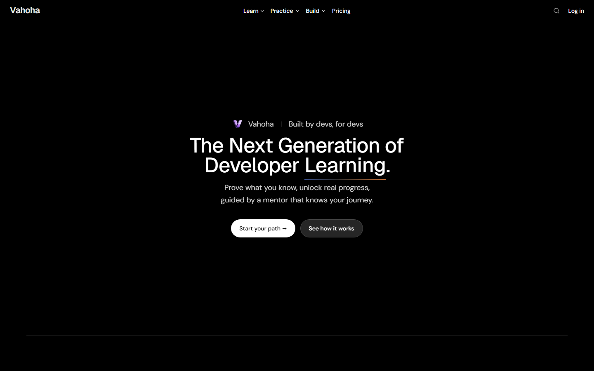
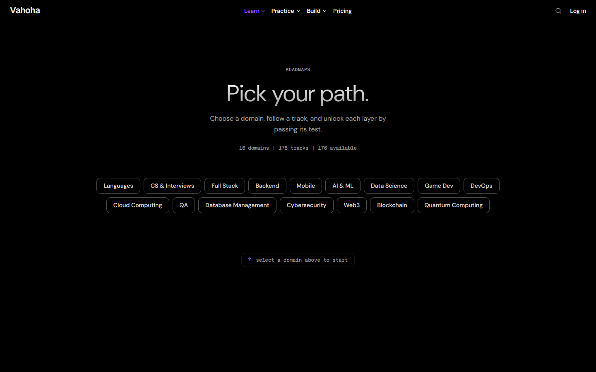
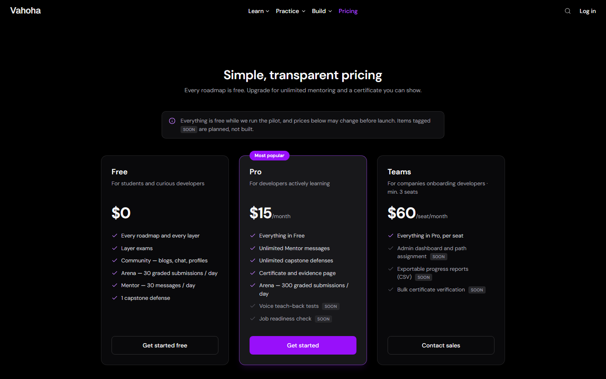
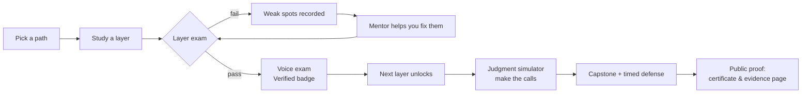

# Vahoha

**Developer learning that won't let you fake it.**

Roadmaps you have to *earn*: server-graded exams gate every layer, spoken exams prove you understood it, and a judgment simulator trains the calls AI can't make for you.

[vahoha.com](https://vahoha.com) · [@vahoha_](https://x.com/vahoha_)

  

  
  

---

## What is Vahoha?

Vahoha is a learning platform for developers who want proof they actually understood what they studied. Every roadmap layer is locked until you pass a server-graded exam on it; failing records your specific weak spots, and a personal mentor (grounded in your real progress and exam history) helps you close them before you retry. The bet: as AI writes more of the code, the developers who stay needed are the ones with judgment and proof of understanding. That is what Vahoha trains and records. Community posts and coding challenges sit around that core loop. Built from scratch, solo, by Vahe Ohanyan. (Formerly called DevsWebs; the repository folder still uses the old name.)

---

## How it works

---

## Tech stack

**Frontend**

**Backend**

**AI**

**Infrastructure**

**Services**

**Testing & DX**

Details

| Layer | Technologies |
|---|---|
| **Frontend** | React 19, Vite 7, Tailwind v4, Zustand, Framer Motion, GSAP, CodeMirror |
| **Backend** | Node.js 22–24 (ESM), Express 5, MongoDB (native driver), Socket.IO, Zod |
| **AI** | Groq (`openai/gpt-oss-120b`) for the mentor, grading and debriefs; Groq Whisper for voice-exam transcription |
| **Auth** | JWT access tokens (15 min) + rotating httpOnly refresh cookie, bcrypt, Google and GitHub OAuth |
| **Billing** | Polar (Merchant of Record), signed webhooks, plan-based caps. Built, **not enforced** (`BILLING_ENFORCED=false`) |
| **Infrastructure** | Redis, BullMQ, Cloudinary, `isolated-vm` (code-runner sandbox), Docker |
| **Email** | Resend |
| **Monitoring** | Sentry (errors, traces, error replays) for the API and the web app; PostHog for product analytics |
| **Testing** | Vitest (unit, integration, API, security, performance, concurrency, WebSocket, queue), Playwright (E2E) |
| **DX** | Husky, lint-staged, ESLint, Swagger UI, nodemon |

---

## Features

**The core loop**

- **Learning roadmaps:** 15 categories of visual paths with tracks and layers. Each layer is locked until you pass its exam; progress is saved server-side
- **Exam engine:** server-graded multiple choice, 15 questions per attempt, pass mark 80. Answer keys never leave the server, choices are shuffled per attempt, unseen questions are served first, 3 attempts per day plus a cooldown after a fail
- **Mentor:** per-user agent with tools into your progress, exam history and weak spots. Socratic (guides, doesn't hand over answers); streaming, sessions, 30 messages a day
- **Voice exam:** answer a layer's questions out loud; the answer is transcribed and graded against a per-layer rubric with evidence points. Passing marks the layer **Verified** on your profile. Rubrics exist for the 15 fullstack paths
- **Judgment simulator:** run a scenario (stage 1: a backend startup), make decisions under pressure, watch the consequences play out, then get a debrief. Rules code decides outcomes so runs are fair and repeatable; the AI only writes text and debriefs
- **Mastery:** per-topic status and a "next step" derived from exams, teach-back and challenge results
- **Dev library:** curated books, docs and guides mapped to roadmap layers
- **Blog posts tagged to layers:** a layer shows the posts written for it
- **Capstones and certificates:** a project brief per track, repo review and a technical defense; passing issues a certificate anyone can verify at `/verify/:id`
- **Project map:** draw how a system fits together (parts, wires, notes), or scan a repo to start one. Undo/redo, PNG/SVG/Mermaid/JSON export, comments on team maps, public read-only links at `/map`
- **Labs:** the Foundations room and the first system lab

**Around it**

- **Coding challenges (Arena):** catalog, sandboxed grading, solve in JavaScript, Python, Ruby, PHP, Java, C++ or Go, explain your solution, community proposals with admin review, XP-priced hints
- **Build Teams:** teams build together; PR sync, per-member defense, ratings and a public evidence page for recruiters
- **Community:** Markdown blog, profiles, follows, DMs and group chat over Socket.IO (voice notes, attachments, reactions), queue-backed notifications
- **Recruiter scorecards:** opt-in public candidate page. The candidates list is built but switched off (`constants/features.js`)
- **Billing:** Polar checkout, subscription state and Free/Pro caps for mentor and capstone (inert until enabled)
- **Pilot analytics:** 7 server-side events and an admin-only funnel (`GET /api/admin/funnel`)
- **Search**, **OAuth**, **dark/light theme**

---

## Status

| Status | Milestone |
|---|---|
| ✅ | Community platform: blogs, profiles, follows, real-time chat |
| ✅ | Learning roadmap: server-side progress, locked layers |
| ✅ | Dev library: curated resources linked to roadmap layers |
| ✅ | Exam engine: server-graded layer exams, pass at 80 |
| ✅ | Mentor: tools into your progress, Socratic, sessions |
| ✅ | Mastery map and learner context |
| ✅ | Coding challenges (Arena): sandboxed grading, proposals |
| ✅ | Billing: Polar, sandbox-verified, not enforced |
| ✅ | Capstones, certificates and Build Teams |
| ✅ | Project map: editor, repo scan, sharing, comments |
| ✅ | Labs: Foundations room, first system lab |
| ✅ | Pilot analytics: events and funnel |
| ✅ | Error monitoring: Sentry on API and web app |
| ✅ | Voice exam: spoken layer exams, rubric grading, Verified badges |
| ✅ | Judgment simulator: stage 1 (engine + one backend scenario) |
| 🟡 | Exam banks: generator built; banks must be seeded and hand-checked per layer |
| 🟡 | Voice-exam rubrics: fullstack done, other categories pending |
| 🔲 | Judgment simulator stages 2–6: investigation, your-project mode, scores, team mode |
| 🔲 | Public progress profiles, full admin panel |
| 🔲 | Real users: the pilot has not started |

Day-to-day status and the pre-pilot checklist: `docs/PILOT_STATUS.md`.

---

## Docs

Full index: [`docs/README.md`](docs/README.md).

| Doc | What it is |
|---|---|
| `VISION.md` | Business and product framing |
| `docs/PILOT_STATUS.md` | What's done, what's left before the first user |
| `docs/founder/OUTREACH_KIT.md` | How to find and interview the first users |
| `docs/product/EXAM_INTEGRITY.md` | Anti-cheating plan and its honest limits |
| `docs/product/XP_SYSTEM.md` | XP ideas, each with a critique |
| `docs/engineering/BILLING.md` | Billing setup and operations |
| `docs/engineering/ARCHITECTURE.md`, `docs/engineering/SECURITY.md` | Technical status |
| `docs/rubric-prompts/` | Prompts and outputs for voice-exam rubrics |
| `docs/founder/` | Founder-skill outputs: idea validation, personas, interview script, competitor matrix |

---

*Built by Vahe — one laptop, one idea, every line of code.*

