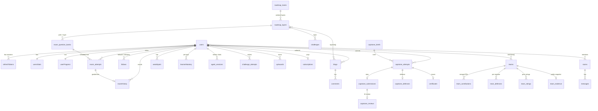

# Data Model

> **Updated:** 2026-10-21. MongoDB (native driver, no Mongoose), database name `DevsBlog`. There are no migrations or schema files: the shape of a document is whatever the service that writes it inserts. Fields below are read from those insert calls. Anything not confirmed is marked `TODO: confirm`.
> See also: [Architecture](ARCHITECTURE.md) · [API](API.md) · [Security](SECURITY.md)

**Contents:** [Relationships](#relationships) · [Collections](#collections) · [Indexes](#indexes) · [Conventions and gaps](#conventions-and-gaps)

---

## Relationships

Everything hangs off `users._id`. Most collections reference it as `userId` (an `ObjectId`).

---

## Collections

### Accounts and auth

| Collection | Key fields | Notes |
|---|---|---|
| `users` | `firstName`, `lastName`, `email`, `password` (bcrypt hash, `null` for OAuth-only), `username`, `provider`, `googleId`, `githubId`, `githubLogin`, `emailVerified`, `role` | `role: "admin"` is the only privileged value. A missing `role` means user. Email is unique only when it is a string (GitHub users may have none). Full field list: `TODO: confirm` |
| `usersStats` | default counters created at signup (`buildDefaultUserStats`) | One per user |
| `refreshTokens` | `userId`, `jtiHash`, `createdAt`, `expiresAt` | Stores a SHA-256 of the token id, never the token. Rotated on use. 30-day TTL |
| `passwordResets` | `tokenHash`, `expiresAt` | Unique hash, TTL index |
| `loginLinks` | `tokenHash`, `email`, `createdAt`, `expiresAt` | Magic-link sign-in. TTL index |
| `usernameHistory` | `oldUsername` | Redirect target for renamed handles |

### Community

| Collection | Key fields | Notes |
|---|---|---|
| `blogs` | `title`, `text`, `category`, `file`, `authorId`, `status`, `layerIds`, `views`, `createdAt` | `layerIds` tags a post to roadmap layers. `slug` and like counters: `TODO: confirm` |
| `comments`, `favouriteBlogs` | `TODO: confirm` | |
| `follows` | `followerId`, `followingId` | Unique pair |
| `blocks` | `blockerId`, `blockedId` | Chat blocks, unique pair |
| `notifications` | `targetUserId`, `createdAt` | Delivered through a BullMQ queue |
| `rooms`, `messages` | `TODO: confirm` | Direct and group chat. Direct room id is the sorted pair of user ids |
| `contact_messages` | name, email, topic, message | |
| `libraryResources`, `savedLibraryResources` | `TODO: confirm` | Dev Library |

### Learning

| Collection | Key fields | Notes |
|---|---|---|
| `roadmap_tracks`, `roadmap_layers` | track id, title; layer `id`, `order`, `requires`, `required`, `stage`, content | Seeded from `src/data/roadmaps/*.json`. Layer ids are positional (`cpp-10`). See [Architecture, roadmap model](ARCHITECTURE.md#6-roadmap-data-model) |
| `userProgress` | `userId`, `activePath`, `currentLayer`, `completedLayers`, `skillLevel`, `xpTotal`, `streak`, `lastActiveAt` | One per user. `layerProgress` map: `TODO: confirm` |
| `exam_question_banks` | `path`, `layer`, `questions[]` (`stem`, `choices`, answer index, `topic`), `reviewed` | 60 questions per layer. Answers never sent to the client |
| `exam_attempts` | `userId`, `path`, `layer`, `questions` (with answer index), `startedAt`, `expiresAt`, `submitted`, `submittedAt`, `passed` | Server-side time limit |
| `examHistory` | `userId`, `path`, `layer`, `score`, `passed`, `totalQuestions`, `correctAnswers`, `missedTopics`, `missedTopicSlugs`, `timeTakenSecs`, `takenAt` | |
| `weakSpots` | `userId`, `topic`, `slug`, `path`, `layer`, `source`, `failCount`, `resolvedAt`, timestamps | `slug` is the identity key |
| `teach_back_rubrics`, `teach_back_sessions` | session: `userId`, `path`, `layer`, `topic`, `topicSlug`, `rubricVersion`, `answerText`, `criteria`, `misconceptionsDetected`, `score`, `passed`, `startedAt` | |
| `concepts` | definitions, prerequisites, misconceptions (`TODO: confirm` fields) | |
| `learnerMastery` | `userId`, `slug`, status fields, timestamps | Unique per user and topic. The single evidence spine |
| `mentor_teaching_log` | `userId`, `slug`, `at` | Recent teaching moves, read per turn |
| `xpAwards` | `userId`, `kind`, `sourceId`, `amount`, `meta`, `applied`, `awardedAt`, `revokedAt` | The XP ledger. Total is `userProgress.xpTotal` |

### Mentor and arena

| Collection | Key fields | Notes |
|---|---|---|
| `agent_sessions` | `userId`, `title`, `pinned`, `messages` | 20-turn window kept. Full shape: `TODO: confirm` |
| `agent_usage` | `userId`, `date`, `count` | Daily mentor message cap (30) |
| `challenges` | slug, track, layer, type, difficulty, starter files, hidden tests | Seeded. `TODO: confirm` full shape |
| `challenge_attempts` | `TODO: confirm` | |
| `challengeResults` | `userId`, `solvedAt`, … | Feeds mastery |
| `submission_usage` | `userId`, `day`, `count`, `expiresAt` | Daily graded-submission counter. Unique per user and day, TTL |

### Capstone and teams

| Collection | Notes |
|---|---|
| `capstone_briefs` | Seeded from `backend/seeders/capstones/`. `published` flag |
| `capstone_attempts`, `capstone_submissions`, `capstone_reviews`, `capstone_defenses` | One flow per learner and track: submit repo, AI rubric review (0 to 4 per criterion), timed defense. Max 3 attempts. AI `usage` is stored on reviews and defenses |
| `capstone_admin_actions`, `certificates` | Overrides and revocations are logged. Certificates have a `publicId` |
| `teams` | `name`, `trackId`, `status` (`forming`, …), `repo`, `members[]`, timestamps. Max 6 members |
| `team_contributions`, `team_defenses`, `team_ratings`, `team_evidence` | Merged PRs per member, per-member defense, peer ratings, public evidence snapshot (`publicId`) |

### Billing and analytics

| Collection | Key fields | Notes |
|---|---|---|
| `subscriptions` | `plan`, `polarSubscriptionId`, `polarCustomerId`, `productId`, `status`, `interval`, `amount`, `currency`, `currentPeriodStart/End`, `cancelAtPeriodEnd`, `canceledAt`, `endsAt`, `startedAt`, `polarModifiedAt`, `polarCreatedAt` | One per user. Only the fields we use are kept, so Polar's API version does not leak into our schema |
| `userEvents` | `userId`, `type` (14 types), `createdAt`, `day` | Pilot funnel. See [Architecture](ARCHITECTURE.md#3-backend-layout) for the event list |

---

## Indexes

Created at startup in `backend/config/db.js`. Failure to build one is logged and does **not** stop the server.

| Collection | Index | Why |
|---|---|---|
| `users` | unique `username`; unique `email` where it is a string | Guard against concurrent signups |
| `passwordResets`, `loginLinks` | unique `tokenHash`; TTL on `expiresAt` | Expired links are swept by Mongo |
| `follows` | unique `followerId + followingId` | |
| `blocks` | unique `blockerId + blockedId`, plus the reverse | |
| `notifications` | `targetUserId, createdAt` | |
| `blogs` | `status, category, createdAt`; `layerIds, status, createdAt` | |
| `exam_attempts` | `userId, path, layer, startedAt` | |
| `teach_back_rubrics` | unique `path, layer, topic` | |
| `teach_back_sessions` | `userId, path, layer, startedAt`; `userId, startedAt` | |
| `weakSpots` | `userId, resolvedAt`; `userId, slug` | Read on every mentor turn |
| `examHistory`, `challengeResults` | `userId` + time, descending | |
| `learnerMastery` | unique `userId + slug` | Concurrent recompute upserts instead of duplicating |
| `mentor_teaching_log` | `userId, slug, at` | |
| `usernameHistory` | unique `oldUsername` | |
| `userEvents` | `userId, createdAt`; `type, createdAt`; unique `userId + day` for `active_day` | |

Collections that create their own indexes in their data module (`capstoneData.js`, `teamsData.js`, `submissionQuotaService.js`): `TODO: confirm` the full list.

---

## Conventions and gaps

- **Ids:** `_id` is an `ObjectId`. References are stored as `ObjectId` (`userId`), not strings.
- **Dates:** JS `Date`. Day counters use a UTC `YYYY-MM-DD` key.
- **Topics:** every topic has a canonical `slug` (`toTopicSlug`). Weak spots, exam misses, teach-back and mastery all join on it.
- **Roadmap ids are positional**, so inserting a layer mid-track orphans progress, attempts, mastery and blog tags (see [Architecture](ARCHITECTURE.md#6-roadmap-data-model)).
- **No schema validation at the database.** Shape is enforced only by the code that writes. There are no migrations. One-off backfills exist as scripts (`npm run migrate:slugs`, `migrate:mastery`).
- **Right to delete:** `DELETE /deleteAccount` removes account data. Which collections it clears: `TODO: confirm` in `accountService.js` (it references `team_defenses`).
- **Cloudinary** holds uploaded images, CVs, voice notes and attachments. Only URLs are stored in Mongo.
