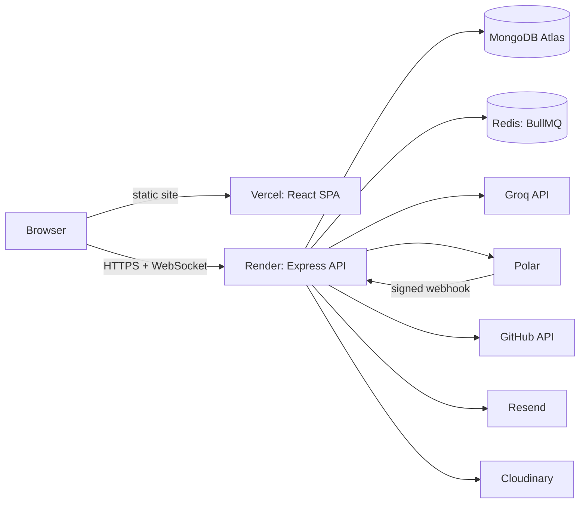

# Deployment

> **Updated:** 2026-10-21. Read from `render.yaml`, `vercel.json`, `Dockerfile`, `.github/workflows/ci.yml`, `package.json` and `backend/server.js`. Nothing here has been verified against a live production deploy. Open items are marked `TODO: confirm`.
> See also: [Architecture](ARCHITECTURE.md) · [Security](SECURITY.md) · [Billing](BILLING.md) · [Pilot status](../PILOT_STATUS.md)

**Contents:** [Overview](#overview) · [Environments](#environments) · [Environment variables](#environment-variables) · [Build and deploy](#build-and-deploy) · [CI](#ci) · [Seeding](#seeding-a-new-database) · [Before each deploy](#before-each-deploy) · [Operating](#operating) · [Not set up yet](#not-set-up-yet)

---

## Overview

| Part | Host | Config |
|---|---|---|
| Frontend (Vite SPA with an SSR prerender pass) | Vercel | `vercel.json` |
| Backend (Express 5 + WebSocket + queue worker, one process) | Render, web service, **free plan**, Frankfurt | `render.yaml` |
| Database | MongoDB Atlas (put it in `eu-central` next to Render) | `MONGO_URI` |
| Queue and counters | Redis (Render Key Value or any Redis) | `REDIS_URL` |
| Email | Resend | `RESEND_API_KEY`, `EMAIL_FROM` |
| Media | Cloudinary | `CLOUDINARY_*` |
| Analytics | PostHog (frontend) | `VITE_POSTHOG_*` |

The backend can also run in Docker (`Dockerfile`, Node 22 alpine, runs as the unprivileged `node` user, listens on 5000). It builds `isolated-vm`, a native addon, so the image installs python3, make and g++.

---

## Environments

| Environment | Frontend | Backend | Notes |
|---|---|---|---|
| Local | `npm run dev` (Vite, port 5173) | `npm run server` (nodemon, port 5000) | `npm run dev:full` starts a Redis container and both |
| Staging | `npm run build:staging` (`--mode staging`) | `TODO: confirm` a staging backend exists | a local `.env.staging` exists |
| Production | Vercel | Render (`https://api.vahoha.com`, a custom domain on the `devs-website` service in `render.yaml`) | Frontend values are set in Vercel |

Backend env files are loaded in this order by `backend/config/bootEnv.js` (the first import of `server.js`): `backend/.env.local`, then `backend/.env`. The paths do not depend on the folder you start the server from.

---

## Environment variables

Names only. **Never commit values.** Backend variables are set on Render (`sync: false` means you enter it in the dashboard).

### Backend

| Group | Variables |
|---|---|
| Core (required) | `MONGO_URI`, `JWT_Secret` (the name has that exact casing), `JWT_REFRESH_SECRET` (must differ from `JWT_Secret`), `FRONTEND_URL` (required in production: `https`, no trailing slash or path; also the CORS origin) |
| Runtime | `NODE_ENV`, `NODE_VERSION`, `PORT`, `HUSKY=0`, `NODE_OPTIONS` |
| AI | `GROQ_API_KEY`, `GROQ_GATE_TPM` (your Groq tier's tokens per minute, so learners together can't go over it), `GROQ_GATE_CONCURRENCY`, `CAPSTONE_REVIEW_MAX_CHARS`, `GEMINI_API_KEY` (unused today: nothing imports `config/gemini.js`) |
| Auth providers | `GOOGLE_CLIENT_ID`, `GITHUB_CLIENT_ID`, `GITHUB_CLIENT_SECRET` (set both or neither), `GITHUB_TOKEN` (repo reads for capstone checks and the Project Map scan; public repos, read-only) |
| Email | `RESEND_API_KEY`, `EMAIL_FROM` (set both or neither), `CONTACT_INBOX` |
| Media | `CLOUDINARY_CLOUD_NAME`, `CLOUDINARY_API_KEY`, `CLOUDINARY_API_SECRET` (all three or none) |
| Redis | `REDIS_ENABLED` (`false` runs without the notification queue and Redis login throttling), `REDIS_URL`, or `REDIS_HOST`, `REDIS_PORT`, `REDIS_PASSWORD` |
| Billing | `POLAR_ENVIRONMENT`, `POLAR_ACCESS_TOKEN`, `POLAR_PRO_PRODUCT_ID`, `POLAR_WEBHOOK_SECRET`, `BILLING_ENFORCED` (see [Billing](BILLING.md)) |
| Switches | `CANDIDATES_ENABLED` (recruiter candidates API, closed by default), `MAINTENANCE_MODE` (every route answers 503), `CACHE_ENABLED` (`false` turns the server cache off), `ALLOW_UNSAFE_RUNNER` (never in production: the server refuses to start), `WS_EXTRA_ORIGINS` |
| Local and scripts only | `GROQ_TPM_LIMIT` (free-tier workaround, never in production), `EVAL_JUDGE_MODEL` (eval script), `DNS_SERVERS`, `ALLOW_UNBANKED_PUBLISH` (capstone seeder) |

`backend/config/env.js` is the source of truth for this list. `.env.example` is generated from it, and `backend/tests/unit/envFiles.unit.test.js` fails if `.env.example`, `render.yaml` or this table drift away from it.

#### Checked at boot

The server validates every variable once, before it connects to anything, and reports **all** problems together. It never prints a value, only the name and what is wrong.

- **It refuses to start** (exit 1) when: `MONGO_URI` is missing or not `mongodb://` / `mongodb+srv://`; `JWT_Secret` or `JWT_REFRESH_SECRET` is missing or they are the same; in production, `FRONTEND_URL` is missing, not `https`, or has a trailing slash or path; in production, `ALLOW_UNSAFE_RUNNER=true`; `BILLING_ENFORCED=true` without the three Polar secrets.
- **It starts and logs a warning** for: a missing `GROQ_API_KEY`, `GITHUB_TOKEN` or `GOOGLE_CLIENT_ID`; a half-set pair (email, GitHub sign-in, Cloudinary); no Redis setting in production; `GROQ_TPM_LIMIT` in production; `CACHE_ENABLED=false` in production; a JWT secret under 32 characters; a number or flag with an invalid value. A feature that is off (no email, no uploads, no billing checkout) is listed with the missing variables in the startup report.

### Frontend (Vercel)

`VITE_API_BASE_URL`, `VITE_WS_URL`, `VITE_GOOGLE_CLIENT_ID`, `VITE_POSTHOG_KEY`, `VITE_POSTHOG_HOST`.

The `.env*` files are gitignored; only `.env.example` is tracked. Production frontend values go in Vercel's project settings (`.env.production` is a local copy). Only public `VITE_*` values belong in the frontend.

---

## Build and deploy

### Backend (Render)

| Step | Command |
|---|---|
| Build | `npm ci --omit=dev` (the API needs no devDependencies) |
| Start | `npm start` = `node --no-node-snapshot backend/server.js` (`--no-node-snapshot` is required by `isolated-vm` on Node 20+) |
| Health check | `GET /healthz` |
| Deploy | `autoDeploy: true`: every push to the connected branch deploys |

On boot the server first checks its configuration (see [Checked at boot](#checked-at-boot)) and exits if a required setting is wrong, then builds indexes (failures are logged, not fatal), then starts HTTP, WebSocket and the notification worker. On `SIGTERM` it closes the worker, queue, Redis and MongoDB in that order.

`isolated-vm` is an optional dependency. If it did not build on the host, the code runner fails closed in production (submissions are refused) unless `ALLOW_UNSAFE_RUNNER=true`. Check the runner after every deploy (`GET /api/challenges/submissions/runner`).

### Frontend (Vercel)

| Step | Command |
|---|---|
| Build | `npm run build`: `prebuild` splits roadmap JSON into `public/roadmaps/`, then `vite build` plus `vite build --ssr src/entry-prerender.jsx`, then `postbuild` runs `scripts/seoPostBuild.js` |
| Routing | `vercel.json` rewrites app sections (`/billing`, `/team`, `/capstone`, …) to `/index.html` and adds security headers (HSTS, `nosniff`, `X-Frame-Options: DENY`, COOP, Referrer-Policy) |
| Caching | `/assets/*` is `immutable` for one year |

A new top-level frontend route needs a matching entry in the `vercel.json` rewrites, or a hard refresh on it will 404. `TODO: confirm` whether the rewrite list is complete for every route in `src/router.jsx`.

---

## CI

`.github/workflows/ci.yml`, on push and pull request to `master`:

1. `npm ci`
2. `npm run lint`
3. `npm run build`
4. `npm run test:unit`

Not in CI: integration, API, security, concurrency, WebSocket, queue, performance and frontend tests, and Playwright e2e. Run them locally before a deploy. A husky pre-commit hook runs `lint-staged` (`eslint --fix` on staged `.js` and `.jsx`).

There is no deploy step in CI. Render and Vercel deploy from their own Git integrations.

---

## Seeding a new database

Seeders write to whichever database `MONGO_URI` points at. **Run them against production only on purpose.**

| Order | Command | What it loads |
|---|---|---|
| 1 | `npm run seed:roadmap` | `roadmap_tracks`, `roadmap_layers` (rerun after any layer change) |
| 2 | `npm run seed:concepts`, `seed:rubrics` | Concepts and teach-back rubrics |
| 3 | `node backend/seeders/examSeeder.js` (or `npm run import:exams` for hand-written banks) | Exam banks, set `layers` in `SEED_CONFIG` for the tracks you open first |
| 4 | `npm run seed:challenges` | Coding challenges |
| 5 | `npm run seed:capstones -- --only-banked` | Capstone briefs; the flag skips tracks with no exam bank yet |
| 6 | `npm run admin:grant -- <email>` | Makes an account an admin (needed for the funnel and Teams admin) |

Imported exam questions arrive as `reviewed: false`. Hand-check the answer keys before opening a track.

---

## Before each deploy

- [ ] `npm run lint`, `npm run build`, `npm run test:unit` pass (CI runs these).
- [ ] Run the relevant extra suites locally (`test:security`, `test:integration`, `test:api`).
- [ ] **HEAD import check:** a clean checkout builds on Linux. Case-only path mismatches and untracked imports pass on Windows and break the Linux build. `TODO: confirm` the exact script or command used for this check.
- [ ] Env vars on Render match the table above. No `GROQ_TPM_LIMIT` in production, and Groq on a paid tier first (the free tier refuses real capstone reviews).
- [ ] Production Polar values, not sandbox. `BILLING_ENFORCED` stays `false` for the pilot.
- [ ] Production GitHub OAuth app with the production callback URL.
- [ ] `vahoha.com` verified in Resend, `EMAIL_FROM` set, or reset and sign-in emails reach no one.
- [ ] Redis reachable (`REDIS_URL`), or `REDIS_ENABLED=false` on purpose. Auth rate limits and notifications depend on it.
- [ ] After deploy: `/healthz` returns OK, the runner reports `isolated-vm`, log in with a fresh account, take an exam, check the funnel.

---

## Operating

| Situation | Check |
|---|---|
| Free Render plan | Sleeps after about 15 idle minutes and takes up to a minute to wake. Chat sockets drop. Move to a paid instance before a real pilot |
| Mentor returns 404 | Groq retired the model. Check `GET https://api.groq.com/openai/v1/models` and update `MODEL` in `modules/ai-agent/services/streamService.js` |
| AI returns 413 | Request tokens exceed the Groq tier's per-minute limit (see [Billing](BILLING.md#ai-cost-and-the-groq-tier)) |
| Polar webhook failing | Polar retries 10 times then disables the endpoint. A missing `POLAR_WEBHOOK_SECRET` returns 503 on purpose |
| Emergency stop | `MAINTENANCE_MODE=true` makes every route answer 503 (`/healthz` stays up) |
| Scaling out | Not safe yet: WebSocket rooms and rate-limit counters are in memory. Pin to one instance |

---

## Not set up yet

- Error monitoring (Sentry): not present.
- Database backups and restore procedure: `TODO: confirm` Atlas settings.
- Staging backend: `TODO: confirm`.
- Automated deploy checks after release (smoke test): none.
- A secrets rotation process. The dev GitHub client secret was pasted into a chat once and should be regenerated.
