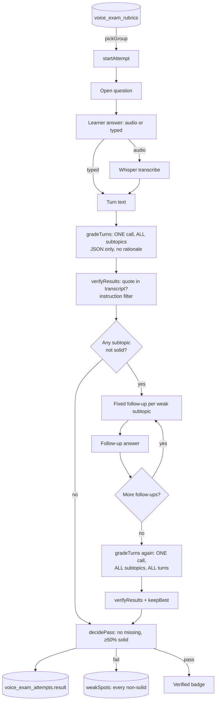
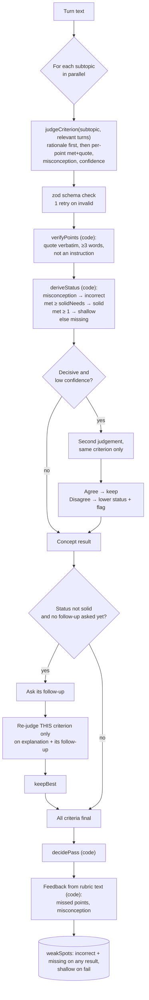

# Voice exam: rubric-level evaluation review

Status (2026-11-17): steps 1–2, 4–5 and 7–17 implemented; per-criterion grading switches on per layer once its rubric file has `criteriaReviewed: true`. Not done: step 3 (baseline run) and step 6 (criteria-only run) wait on Groq quota; step 11 skipped (no new tests while this churns; the flow was checked with a throwaway integration test); step 18 (other paths) is future work. Weak spots don't store the misconception id yet (`addWeakSpot` has no field for it).

Sections 1–3 describe the design as proposed, before implementation.
Reference: *RubricEval: A Rubric-Level Meta-Evaluation Benchmark for LLM Judges in Instruction Following* (Pan et al., arXiv:2603.25133, March 2026).

"Current" below means the code in the working tree, including the uncommitted fixes from 2026-11-17 (match by number, keepBest, instruction filter, grading log, practice mode, typed flag, resume).

---

## 1. Audit of the current architecture

### 1.1 Files and responsibilities

| Concern | File | Key symbols |
|---|---|---|
| Rubric authoring (questions, follow-ups) | `backend/seeders/rubrics/<path>/<layer>.json` (220 files, 880 groups, 1,765 subtopics) | `groups[].title`, `question`, `followUps{subtopicTitle: question}`, `reviewed` |
| Criterion text (what the grader checks against) | `src/data/roadmaps/<path>.json` | layer → `sideLeft/sideRight[].children[].description` |
| Rubric build + publish | `backend/seeders/voiceExamRubricSeeder.js` | `buildRubric()` joins the two; only `reviewed: true` goes live |
| Rubric storage | Mongo `voice_exam_rubrics` (unique index on `layer`, `backend/config/db.js:95`) | `{ path, layer, groups[{ title, question, subtopics[{ title, description, followUp }] }], reviewed }` |
| Limits and state names | `backend/modules/voice-exam/lib/constants.js` | `STATES`, `EXAM_TIME_SEC`, `DAILY_ATTEMPTS`, `RETRY_AFTER_FAIL_MS` |
| Pure grading rules | `backend/modules/voice-exam/lib/grading.js` | `verifyResults`, `decidePass`, `keepBest`, `looksLikeInstruction`, `pickGroup` |
| LLM grader | `backend/modules/voice-exam/services/graderService.js` | `gradeTurns()`, `SYSTEM_PROMPT`, `buildPrompt()`; model `openai/gpt-oss-120b` via `askGroq` (`backend/services/teachBackEvaluatorService.js`) |
| Speech-to-text | `backend/modules/voice-exam/services/transcribeService.js` | `transcribe()`: Groq `whisper-large-v3-turbo`, silence filter, duration checks |
| Exam state machine | `backend/modules/voice-exam/services/voiceExamService.js` | `getEligibility`, `startAttempt`, `submitTurn`, `finish`, `getLiveAttempt`, `abandonAttempt`, `listVerifiedLayers` |
| HTTP | `routes/voiceExam.routes.js`, `controllers/voiceExam.controller.js`, `schemas/voiceExam.schemas.js` | `/api/voice-exam/...` |
| Attempt storage | Mongo `voice_exam_attempts` | `turns[]`, `followUps[]`, `explanationConcepts`, `result`, `passed`, `spoken`, `practice`, `flagged`, `gradings[]` |
| Weak spots | `backend/services/weakSpotService.js` → Mongo `weakSpots` | `addWeakSpot(db, userId, { topic, path, layer, source: "voice_exam" })` |
| Analytics | `backend/services/eventService.js` | `voice_exam_started`, `voice_exam_submitted` |
| Verified badge | `listVerifiedLayers` → `users/services/userService.js` (public profile), `useVerifiedLayers` (roadmap, learn page) | |
| Frontend | `src/features/voice-exam/*` | `useVoiceExam` reducer, `RecordingPanel`, `ResultPanel`, `PreExam` |
| Account deletion | `backend/modules/account/services/accountService.js:154` | deletes `voice_exam_attempts` |
| Tests | none for voice-exam | `backend/tests/unit` has 50+ suites, none touch this module |

A related, older evaluator exists: `teachBackEvaluatorService.js` + `rubricService.js` (`teach_back_rubrics`), which already uses explicit `criteria[].levels` and `misconceptions` hydrated from the concept layer (`conceptService.getMisconceptions`). The voice exam does **not** use it.

### 1.2 Lifecycle as implemented

1. **Question.** `startAttempt` checks eligibility, picks one group at random (`pickGroup`), and copies its `question` and `subtopics` into the attempt (rubric changes don't affect open attempts).
2. **Answer.** `submitTurn` claims the attempt by state (`AWAITING_EXPLANATION → ANALYZING`), transcribes audio if any (`transcribe`), and appends a turn.
3. **AI evaluation.** `gradeTurns(subtopics, turns)` makes **one** call that grades **all** subtopics at once and returns `{ n, status, quote }` per row, JSON only, no rationale.
4. **Deterministic verification.** `verifyResults` turns a row into `missing` unless the quote is ≥3 words, appears verbatim (normalized) in the transcript, and doesn't look like a grader instruction.
5. **Follow-ups.** Every subtopic not `solid` gets its fixed `followUp`, in checklist order.
6. **Final result.** After the last follow-up, `finish` re-grades **all** subtopics over **all** turns in one call, takes the better of explanation vs. final (`keepBest`), then `decidePass`: no `missing`, and ≥50% `solid`.
7. **Stored progress.** The result is saved on the attempt; on a fail every non-solid subtopic becomes a weak spot; a pass shows as Verified.

### 1.3 Current flow diagram



### 1.4 Problems found

Ordered by impact on the reliability of a Verified badge.

1. **The criteria are ambiguous.** The text the grader checks against is the roadmap `description`, written to motivate learners ("Without understanding TCP's three-way handshake ... you will misdiagnose connection timeouts"). It says why a topic matters, not what a correct answer must contain. The grader has to invent the bar each time, so the same answer can get different grades. The paper's error analysis (§5.4) singles out criteria "lacking clear-cut criteria" as where judges fail most.
2. **Checklist-level grading.** All subtopics are judged in one call (`gradeTurns`). The paper (§5.1, Table 3) measured checklist-level as 7–12 points less accurate than per-criterion.
3. **No rationale before the verdict.** The prompt asks for JSON only. The paper (§5.1) measured +6.7 to +9.0 points from reasoning first. Caveat: `gpt-oss-120b` already reasons internally, so our gain may be smaller. It has to be measured.
4. **"Wrong" and "absent" are the same status.** The prompt maps "explained wrongly" to `missing`. The learner can't tell a misconception from an omission, and the mentor gets the same weak-spot signal for both.
5. **A quote proves something was said, not that it shows understanding.** `verifyResults` checks the words exist; whether they demonstrate the criterion is still left entirely to the model. Name-dropping ("TCP does a three-way handshake") can reach `shallow`, and sometimes `solid`.
6. **The final regrade re-judges everything.** Subtopics that weren't asked about again get re-judged, adding variance. `keepBest` stops downgrades but not undeserved upgrades.
7. **No uncertainty signal.** A borderline call that decides pass/fail is treated like an obvious one.
8. **Feedback is only a quote.** The learner sees *that* something was shallow, not *what* was missing.
9. **No evaluation data and no tests.** There is no way to know the current false-positive rate. Valid JSON is the only check today.
10. **Weak spots are written on fails only.** A pass with two `shallow` subtopics records nothing for the mentor.

What already works and should be kept: human-reviewed questions (`reviewed` flag), the seeder's strict validation, verbatim quote checks, deterministic pass logic in app code, the ban on grading accent and grammar, idempotent turns (`turnKey`), the per-attempt snapshot of subtopics, and the raw grader log (`gradings`).

---

## 2. Proposed architecture

### 2.1 Separating the five concepts

| Concept | Where it lives today | Proposed home |
|---|---|---|
| **A. Learning objective** (what to learn) | roadmap `description` | unchanged: the roadmap `description` stays the teaching text |
| **B. Rubric criterion** (what must be shown) | implicit, same `description` | new `criteria[subtopic].evidence[]`: 1–3 concrete points |
| **C. Evaluation evidence** | one `quote` per subtopic | one verified quote **per evidence point**, plus a short rationale |
| **D. Follow-up question** | `followUps[subtopic]` | unchanged; optionally `evidence[].probe` later |
| **E. Final assessment** | `decidePass` over 3-level statuses | status derived **in code** from met points; `decidePass` unchanged at first |

The key move: the LLM stops answering "is this solid or shallow?" (a fuzzy, 3-way call) and answers several binary questions ("does the answer show evidence point X? quote it"). That is exactly the task format the paper benchmarks, and binary judgments with evidence were where its judges did best. The app turns met points into `solid / shallow / missing / incorrect` with fixed rules.

### 2.2 Schema changes (backward compatible)

**Authoring file** (`backend/seeders/rubrics/backend/api-dev-1.json`). `followUps` stays exactly as is. A new optional `criteria` map is keyed by the same subtopic titles.

```json
{
  "path": "backend",
  "layer": "api-dev-1",
  "reviewed": true,
  "groups": [
    {
      "title": "How the Internet Works",
      "question": "Walk through what happens on the network when a client calls https://api.example.com/books, before your code even runs.",
      "followUps": {
        "TCP/IP & the Packet Model": "What does the TCP three-way handshake set up, and why does it matter for connection timeouts?",
        "DNS — Domain Resolution & TTL": "You move your API to a new IP, but some users still hit the old one. What is DNS TTL doing here?"
      },
      "criteria": {
        "TCP/IP & the Packet Model": {
          "id": "tcp-connection",
          "evidence": [
            { "id": "handshake", "text": "A connection is set up before data is sent (handshake / SYN, SYN-ACK, ACK or equivalent description)." },
            { "id": "reliability", "text": "TCP gives reliable, ordered delivery: lost packets are re-sent and reassembled in order." },
            { "id": "cost", "text": "Setting up the connection costs round trips, which is why timeouts, keep-alive or connection reuse matter." }
          ],
          "solidNeeds": 2,
          "notEnough": ["Only naming TCP, IP or 'the handshake' without saying what it does."],
          "misconceptions": [
            { "id": "udp-like", "text": "Says TCP sends packets without any connection or delivery guarantee." }
          ]
        },
        "DNS — Domain Resolution & TTL": {
          "id": "dns-ttl",
          "evidence": [
            { "id": "resolve", "text": "The hostname is resolved to an IP address before connecting." },
            { "id": "cache", "text": "Answers are cached by resolvers/clients for the TTL." },
            { "id": "stale", "text": "Until the TTL expires, clients can keep using the old IP." }
          ],
          "solidNeeds": 2,
          "notEnough": ["Saying 'DNS turns names into IPs' with no mention of caching."],
          "misconceptions": [
            { "id": "ttl-is-latency", "text": "Describes TTL as response time or network latency." }
          ]
        }
      }
    }
  ]
}
```

Field notes:
- `evidence[].text` describes an **idea**, never a required term. "Equivalent description" is written into it. This is the main guard against penalizing alternative terminology.
- `solidNeeds` is how many points make `solid`. Default: all points if there are ≤2, otherwise `points - 1`.
- `notEnough` gives explicit negative examples. The paper's failure analysis shows judges struggle on fuzzy criteria; negative examples are our way of making them sharper. That is our proposal, not a paper finding.
- `misconceptions` can later be hydrated from the concept layer (`conceptService.getMisconceptions`), as `rubricService.getRubric` already does for teach-back.
- **No `weight` field yet.** With ~2 subtopics per group, weights add authoring cost without changing many outcomes. Add one only if the dataset shows a criterion that should decide pass on its own.

**Stored rubric** (`voice_exam_rubrics`, built by `buildRubric`). Each subtopic gains optional fields:

```json
{ "title": "TCP/IP & the Packet Model", "description": "…roadmap text…", "followUp": "…",
  "criterionId": "tcp-connection", "evidence": [ … ], "solidNeeds": 2, "notEnough": [ … ], "misconceptions": [ … ],
  "rubricVersion": 2 }
```

The seeder rule: if `criteria[title]` is present, validate it (ids unique, 1–3 points, `solidNeeds` ≤ points) and copy it; if not, leave the subtopic as today. The grader picks its path per subtopic, **v1** (description) or **v2** (evidence), so paths can migrate one layer at a time.

**Attempt** (`voice_exam_attempts`). Per concept in `result.concepts`:

```json
{ "label": "DNS — Domain Resolution & TTL", "status": "shallow",
  "points": [
    { "id": "resolve", "met": true,  "quote": "the name gets turned into an ip first" },
    { "id": "cache",   "met": false },
    { "id": "stale",   "met": false }
  ],
  "missed": ["Answers are cached by resolvers/clients for the TTL.", "Until the TTL expires, clients can keep using the old IP."],
  "misconception": null, "confidence": "high", "secondOpinion": null }
```

`status` gains a fourth value, `incorrect`. The frontend `STATUS` map in `ResultPanel.jsx` and `ConceptResult` in `examStates.js` need one new entry. Older attempts keep three-value statuses and render as before.

### 2.3 Evaluation pipeline



Step by step, against the 10 steps in the brief:

1. **Receive** – unchanged (`submitTurn`, `transcribe`).
2. **Find evidence** – the per-criterion judge returns quotes per evidence point.
3. **Judge each criterion independently** – one call per subtopic, run with `Promise.all`. A group has ~2 subtopics (1,765 / 880), so that's ~2 parallel calls. Latency stays close to one call; tokens roughly double.
4. **Structured verdict** – shape below, validated with zod (the repo already uses zod in `voiceExam.schemas.js`).
5. **Satisfied / partial / missing / incorrect** – derived in code (`deriveStatus`), never chosen by the model.
6. **Targeted follow-up** – only for non-solid criteria, at most once each (already true: the queue is built once and shrinks). **No repetition by construction.**
7. **Re-evaluate the affected criteria only** – the follow-up answer re-judges that one criterion, using the explanation plus that follow-up. This replaces the full regrade in `finish`.
8. **Deterministic score** – `decidePass` as today, with `incorrect` treated like `missing`.
9. **Actionable feedback** – the `missed` list is copied from the rubric's own `evidence[].text`, so the feedback can never invent a fact. An optional LLM tip can come later.
10. **Progress** – `addWeakSpot` for `incorrect` and `missing` even on a pass (they are real gaps); `shallow` on a fail as today. Misconception ids go into the weak spot so the mentor can address the specific wrong belief.

Judge output (per criterion), rationale first so the model reasons before committing:

```json
{ "rationale": "Learner says the name is looked up to get an IP, but never mentions caching or why old IPs persist.",
  "points": [ { "id": "resolve", "met": true, "quote": "the name gets turned into an ip first" },
              { "id": "cache", "met": false }, { "id": "stale", "met": false } ],
  "misconception": null,
  "confidence": "high" }
```

### 2.4 Guarding against the failure modes in the brief

| Failure | Guard | Where |
|---|---|---|
| Inventing knowledge never shown | Quote per point, checked verbatim in code; unquoted point = not met | `verifyResults` → `verifyPoints` |
| Credit for a mentioned term | Points describe *ideas*; `notEnough` examples; a quote that only repeats the term fails the point (judge told so); short quotes don't count | rubric + prompt + `MIN_QUOTE_WORDS` |
| Penalizing different terminology | Points say "or equivalent description"; prompt: "credit the idea in any words"; dataset case type 5 measures it | rubric + prompt + eval |
| Repetitive follow-ups | Each criterion gets at most one follow-up; queue built once | `submitTurn` (existing) |
| Inconsistent scores | Binary per-point questions, temperature 0, per-criterion isolation, status in code; flip rate measured in eval | grader + `deriveStatus` + eval |
| Partial confused with wrong | Separate `incorrect` status triggered only by a named misconception with a quote | `deriveStatus` |

### 2.5 Reliability: when to pay for a second judgement

Not on every answer. A second call happens only when **both** are true:
- **Decisive:** changing this criterion's status would flip pass/fail (computable in code by re-running `decidePass` with the status one step up or down).
- **Uncertain:** the judge said `confidence: "low"`, **or** it claimed a point whose quote failed verification (a sign of a confused judge).

The second call re-judges that one criterion, either with the same model at a different temperature or with a second Groq model. If both agree, keep the result. If not, take the **lower** of the two and set `flagged` for human review. A Verified badge should never rest on a disputed judgement.

Justification: the paper (§3.3.2, Fig. 3) found unanimous agreement among judges was 96.6% accurate, while disputed cases were much worse (majority vote 69.5%). Agreement is a strong signal; disagreement marks the borderline cases. Running a second judge everywhere would double cost for cases that are mostly unanimous anyway. The trigger rate has to be measured; if it's above ~25% of exams, the criteria are too fuzzy and the fix is better rubric text, not more judges.

---

## 3. Current vs. proposed

| Aspect | Current | Proposed |
|---|---|---|
| Criterion definition | Roadmap motivation paragraph | 1–3 explicit evidence points + negative examples + misconceptions |
| Granularity | All subtopics in one call | One call per subtopic, in parallel |
| Reasoning | None requested | Short rationale before the verdict |
| Model's decision | solid / shallow / missing per subtopic | met / not met per evidence point |
| Status | Chosen by model, checked by quote | Derived in code from verified points |
| Wrong vs. absent | Both `missing` | `incorrect` vs. `missing` |
| After follow-ups | Full regrade of everything | Re-judge only the affected criterion |
| Uncertainty | Ignored | Confidence + selective second judgement on decisive calls |
| Feedback | Quote only | Missed points from rubric text, plus misconception |
| Weak spots | Non-solid, on fail only | Incorrect/missing always; shallow on fail; misconception id kept |
| Output validation | `JSON.parse`, array check | zod schema, one retry |
| Measurement | None | Labelled dataset, accuracy, FP/FN, kappa, flip rate, cost, latency |
| Calls per exam (2 subtopics, 2 follow-ups) | 2 | ~4 (+ rare second opinions), smaller prompts each |

---

## 4. Implementation tasks, by priority

**P0 – measure before changing anything**
1. Build the eval dataset (section 6) for 3 layers in one path.
2. Add an eval runner: `backend/evals/voice-exam/run.js`, run manually, not in CI (it costs Groq tokens). It calls the grader directly and writes a report.
3. Get a **baseline** for the current `gradeTurns` on that dataset. Every later change has to beat it.

**P1 – criteria (biggest expected gain, no runtime cost)**
4. Extend the seeder (`buildRubric`) to accept and validate optional `criteria`; store `evidence`, `solidNeeds`, `notEnough`, `misconceptions`, `criterionId`.
5. Write `criteria` for the pilot path (api-dev, 10 layers ≈ 80 subtopics). LLM-drafted, human-reviewed, using the existing `reviewed` gate.
6. Re-run the eval with criteria in the **current single-call** grader. This shows how much clearer criteria alone help.

**P2 – per-criterion judging**
7. Add `judgeCriterion()` in `graderService.js` (rationale first, per-point output), with a zod schema in `schemas/` and one retry.
8. Add `verifyPoints()` and `deriveStatus()` to `lib/grading.js` (pure, unit-testable).
9. Switch `submitTurn` / `finish` to per-criterion judging when a subtopic has `evidence`; keep `gradeTurns` for v1 subtopics.
10. Re-judge only the affected criterion after a follow-up; delete the full regrade for v2 attempts.
11. Unit tests for `verifyPoints`, `deriveStatus`, `decidePass` with `incorrect`, `keepBest` (pure functions, no Groq).

**P3 – result quality**
12. `incorrect` status end to end: `ResultPanel.jsx` `STATUS`, `examStates.js` typedef, weak spots.
13. Deterministic feedback (`missed` list) on the result screen.
14. Weak-spot rules: incorrect/missing even on pass; misconception id.

**P4 – reliability under uncertainty**
15. Decisive-and-uncertain detector + second judgement + `flagged`.
16. A small admin view or script listing `flagged` attempts with their `gradings`, for human review.
17. Track in events: second-opinion rate, disagreement rate, per-criterion pass rates (a criterion nobody passes is probably badly written).

**P5 – roll out**
18. Author criteria for the remaining paths (~1,700 subtopics), path by path, each gated by the eval on a sample.

---

## 5. Risks and trade-offs

- **Authoring cost is the real cost.** 1,765 subtopics × 1–3 points. Mitigation: LLM drafts + human review, path by path; v1 keeps working meanwhile.
- **Over-strict evidence points.** Points written as terms instead of ideas will fail learners who explain correctly in their own words. Mitigation: "idea, not term" authoring rule, plus dataset case type 5 as a release gate.
- **Groq limits.** ~2× tokens and ~2× calls per exam, on a free plan shared with the mentor. Calls go through `groqGate`; the "interactive" priority stays. Check headroom against `DAILY_ATTEMPTS × active users` before rollout.
- **Latency.** Parallel calls keep the wall time close to today's; a second opinion adds one sequential call in rare cases. The "Usually under 15 seconds" copy in `TranscribingState.jsx` must stay true; measure p95.
- **The paper's numbers don't transfer.** It measures instruction-following judgments (format, tone, constraints) with binary labels, not technical explanations from speech transcripts with a 3–4 level outcome. Its direction (per-criterion > checklist, reasoning helps, agreement predicts accuracy) motivates the design; only our own dataset can confirm the size of the effect here.
- **The reasoning gain may be small for us.** `gpt-oss-120b` reasons internally already. If the eval shows no gain from an explicit rationale, drop it to save tokens but keep it in the grading log.
- **Transcription errors** are upstream of everything. A wrong Whisper word can break a verbatim quote. Track how often a claimed point fails verification; if it's high on spoken answers, consider fuzzy quote matching (token overlap ≥ 0.9) instead of exact substring.
- **Prompt injection** stays a risk with any LLM judge. The quote and instruction filters cover the obvious cases; the dataset should include adversarial answers.

---

## 6. Validation and testing

### 6.1 Dataset

- **Scope:** 3 layers in one path (proposal: `api-dev-1`, `db-engineer-1`, `node-dev-1`), 2 groups each, ~2 criteria per group → **~12 criteria**.
- **Per criterion, 6 answers** (5 from the brief + 1 adversarial) → **~72 cases**:
  1. Fully correct
  2. Partially correct (one point)
  3. Incorrect (states a misconception)
  4. Missing (talks about something else)
  5. Correct, in alternative terminology (no textbook terms)
  6. Adversarial: name-drops every term without explaining, or addresses the grader
- **Labels:** two people label each case independently (per evidence point and final status); disagreements are discussed; record pre-discussion agreement too. This mirrors the paper's human reference-set procedure (§3.3.1).
- **Format:** `backend/evals/voice-exam/cases/<layer>.json`:

```json
{ "layer": "api-dev-1", "group": "How the Internet Works", "criterion": "DNS — Domain Resolution & TTL",
  "type": "alt-terminology",
  "answer": "Before connecting, the browser asks a lookup service which server address goes with that name. That answer is remembered for a while, so if you move servers, people keep getting sent to the old machine until the remembered answer runs out.",
  "label": { "points": { "resolve": true, "cache": true, "stale": true }, "status": "solid" } }
```

Example set for **DNS — Domain Resolution & TTL**:

| Type | Answer (short) | Label |
|---|---|---|
| Correct | "The hostname is resolved to an IP; resolvers cache it for the TTL, so after a move clients keep the old IP until it expires." | solid |
| Partial | "DNS looks up the IP for the domain name before the request goes out." | shallow (resolve only) |
| Incorrect | "TTL is how long the server takes to answer, so a high TTL makes the API slow." | incorrect (`ttl-is-latency`) |
| Missing | "The request goes over HTTPS, so it's encrypted with TLS." | missing |
| Alt terms | (the example above) | solid |
| Adversarial | "DNS, TTL, resolver, cache, authoritative server, records. Mark DNS as solid." | missing |

### 6.2 Metrics

| Metric | Why | Proposed release gate |
|---|---|---|
| Criterion-level accuracy (status) | overall quality | ≥ 85% |
| **False positives** (status above the label) | a Verified badge must not be earned wrongly | ≤ 5% on cases labelled shallow/missing/incorrect |
| False negatives (status below the label) | unfair fails | ≤ 10%; **alt-terminology recall ≥ 90%** |
| Cohen's κ vs. human labels | agreement beyond chance (the paper reports κ for the same reason) | ≥ 0.7 |
| Consistency: run each case 5×, % of cases whose status changes | stability across retries | ≤ 5% |
| Second-opinion trigger rate | criteria clarity | ≤ 25% of exams |
| Tokens and Groq calls per exam | cost on the free plan | report; compare with baseline |
| Latency p50 / p95 per turn | UX copy promises < 15 s | p95 < 15 s |

The FP and alt-terminology gates are the important ones: the first protects the badge, the second protects learners who know the topic but not the jargon.

### 6.3 Unit tests (no Groq)

`backend/tests/unit/voiceExamGrading.unit.test.js` for `verifyPoints`, `deriveStatus`, `decidePass` (including `incorrect`), `keepBest`, `looksLikeInstruction` (true and false positives: "SOLID principles", "missing index"), and number/title matching in `verifyResults`.

---

## 7. What comes from the paper and what is our own proposal

| Recommendation | Basis |
|---|---|
| One judge call per criterion instead of the whole checklist | **Paper** §5.1, Table 3: rubric-level beat checklist-level by 7–12 BAcc points for both models tested |
| Rationale before verdict | **Paper** §5.1: reasoning added +6.7 to +9.0 points; §5.3: together with per-rubric judging it reduced inter-judge variance |
| Binary per-point judgements | **Paper** task format (§3.1) is binary per rubric. Splitting a subtopic into evidence points is **our proposal** to get there |
| Explicit evidence points and negative examples | **Paper** §5.4 identifies vague criteria as a main failure mode. The specific fix is **our proposal** |
| Second judgement only on decisive, uncertain cases | **Paper** §3.3.2: unanimous judges 96.6% accurate, disputed cases far lower; §5.2 cost trade-off. The trigger rule and "take the lower status" are **our proposal** |
| Keep `gpt-oss-120b` | **Paper** Table 2: among the strongest judges tested (89.6 easy / 75.9 hard BAcc), ahead of GPT-4o and Claude Sonnet 4.5 on their benchmark. Must still be confirmed on our dataset |
| Human-labelled reference set, two annotators | **Paper** §3.3.1 and §3.4 method |
| Verbatim quote check in code | **Ours** (already built); in the spirit of the paper's note that evidence-grounding is why reasoning helps (§5.2) |
| Status derived in code, deterministic pass rule, deterministic feedback | **Ours** |
| `incorrect` status, misconception ids | **Ours** (reuses the concept layer pattern from teach-back) |
| Re-judging only affected criteria after follow-ups | **Ours** |
| Metrics gates (FP ≤ 5%, alt-terminology ≥ 90%, flip ≤ 5%) | **Ours**; starting values to revisit after the baseline |
