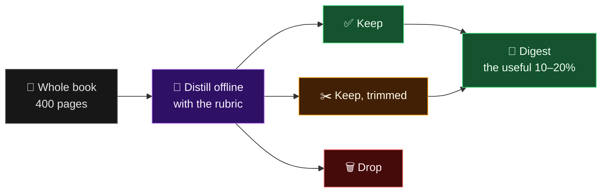
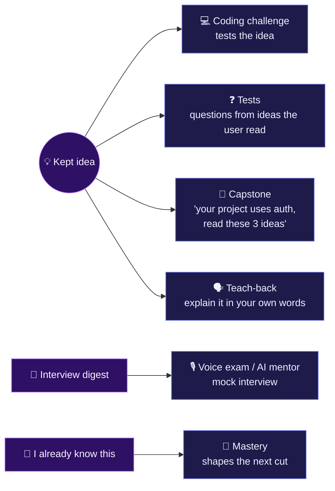
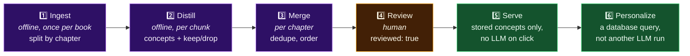
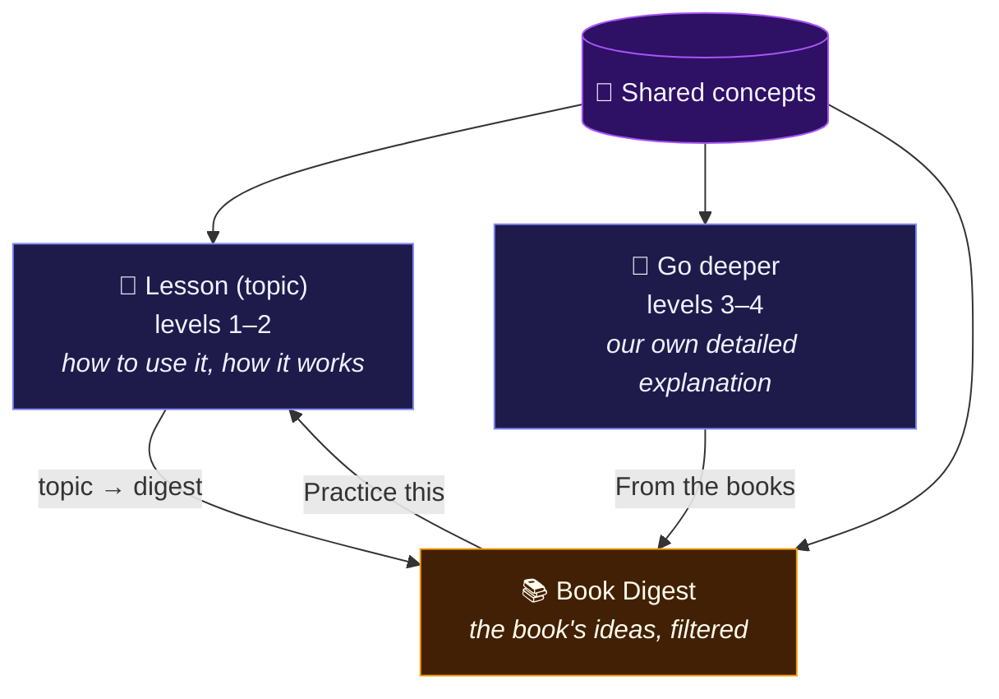

# 📚 Book Digest

> [!NOTE]
> **Status:** 💡 idea, shaped on 2026-10-16. **Not built.**
> Comes **after the MERN pilot** of the learning system, and is built on that
> system's concept store and rubric (see [§10](#10--connection-to-the-learning-system)).
> Pricing, free vs Pro and team access are deliberately out of scope for now.

**Contents:** [1 · Idea](#1--the-idea-in-one-paragraph) · [2 · Features](#2--core-features) · [3 · Connections](#3--connections-to-what-is-already-built) · [4 · Data](#4--data-shape-draft) · [5 · Pipeline](#5-%EF%B8%8F-pipeline) · [6 · The rule](#6--the-rule-that-makes-it-work) · [7 · Risks](#7-%EF%B8%8F-risks) · [8 · Build order](#8-%EF%B8%8F-suggested-build-order) · [9 · Parked](#9--parked-for-later) · [10 · Learning system](#10--connection-to-the-learning-system)

---

## 1. 💡 The idea in one paragraph

The code library page doesn't show full books and isn't a link list. It shows
**book titles**. When a user clicks a title, the system opens a **digest**: the
book's ideas, shortened and filtered down to what a developer actually needs
today. An LLM reads the whole book offline, pulls out the ideas, and decides what
to keep, shorten or drop. **The user never reads the 400 pages, only the useful 10–20%.**



**Example: *Learning TypeScript*, chapter on arrays**

| Decision | Idea | How much of it |
| :---: | --- | --- |
| ✅ Keep | Multidimensional arrays | One short paragraph and one example |
| ✂️ Keep, trimmed | Arrays are unsound: `elements[9001]` compiles but crashes | Two lines, not the full section |
| 🗑️ Drop | How members of union-typed arrays are typed | Rarely matters in practice |

> [!TIP]
> **The filter is the valuable part.** A summary tells you what the book says.
> The filter tells you what you need.

---

## 2. ✨ Core features

### 2.1 🎯 Personalized cut
The same book is cut differently for different readers.

| Cut by | Example |
| --- | --- |
| **Level** | A beginner gets the basics with more examples; a senior gets only the traps and the "why" |
| **Goal** | Get a job · build a startup · pass the test · switch from another language |
| **What they already know** | Uses mastery data: if they know arrays, the arrays chapter disappears |
| **Roadmap position** | On the TypeScript layer, show only what that layer needs |

> Start with **ONE** version (no personalization) and add these cuts after the base digest works.

### 2.2 ➕ "Expand this"
Each short idea has a button that reveals the original detail that was cut.
Nothing is lost, and the user decides the depth. The detail is **generated once
at ingest**, never at click time.

### 2.3 🙈 "I already know this"
One click hides an idea for good. The system records it and learns what to skip.

> [!WARNING]
> This is a **self-reported** signal, weaker than a passed challenge or test.
> Store it separately and **never count it as a pass** or mark a lesson done.

### 2.4 🎤 Interview mode
A second kind of digest cut from the same book: only what interviews ask about.

| Per concept | Example (arrays chapter) |
| --- | --- |
| The likely question | *"Why doesn't TypeScript catch `elements[9001].length`?"* |
| The short strong answer | Index access is unsound by default |
| The common wrong answer / trap | "TypeScript checks array bounds" |
| One follow-up | *"How would you make it safer?"* → `--noUncheckedIndexedAccess` |

Runs as flashcards, a mock interview with the AI mentor, or voice (the voice-exam feature exists).

---

## 3. 🔌 Connections to what is already built



---

## 4. 🧾 Data shape (draft)

```text
Source   { _id, title, author, license, sourceUrl, topic, ingestedAt }
Chunk    { _id, sourceId, chapter, order, text }          // raw text, server-side only, never shown
Concept  { _id, sourceId, chapter, order,
           title, summary, example?, whyItMatters,
           detail,                                         // the "Expand this" text
           importance: 1-5, levels: [beginner|intermediate|senior],
           goals: [job|startup|exam|switch], tags: [],
           topics: [],                                     // roadmap topics it belongs to (§10)
           keep: boolean, dropReason?,
           interview?: { question, answer, trap, followUp },
           challengeIds?: [], reviewed: boolean, promptVersion }
UserConceptState { userId, conceptId, state: hidden | known | read, at }
```

Validate the LLM output with **Zod at the boundary**, the same way the rest of the backend does.

---

## 5. ⚙️ Pipeline



| Step | Detail |
| --- | --- |
| **1. Ingest** | Split by chapter and section, not by raw size. Store as `Chunk`s |
| **2. Distill** | The LLM extracts concepts: summary, "Expand this" detail, importance, levels, goals, keep or drop with a reason. Interview block when interview-worthy |
| **3. Merge** | Remove duplicates, order the concepts |
| **4. Review** | A human approves each digest before it's shown (`reviewed: true`), like test questions with `reviewed: false` |
| **5. Serve** | The page reads stored concepts only: fast, and free per view |
| **6. Personalize** | Filtering by level, goal, mastery and hidden ideas is a database query |

> Version every prompt (`promptVersion`), so improving it later re-runs only the affected books.

---

## 6. 📏 The rule that makes it work

> [!IMPORTANT]
> "What counts as needed today" must be an **explicit rubric** the LLM follows, for example:
> - Would a developer building real projects with current tools and AI assistance need this?
> - Is it a common trap?
> - Is it only a niche edge case, or outdated practice?
>
> Writing and testing this rubric is the core learning piece of the feature. **It should be written by hand, not generated.**

---

## 7. ⚠️ Risks

| Risk | Why it matters | Mitigation |
| --- | --- | --- |
| ⚖️ **Copyright** | Commercial books (O'Reilly, Manning…) are copyrighted; an AI-condensed version is a risk even when reworded | Use open-licensed books, official docs (MDN, the TypeScript Handbook), or author permission. Decide the source list before ingesting anything |
| 🎯 **Accuracy** | The LLM can drop an important idea or state something wrong; a wrong interview answer is worse than a missing one | The human review step |
| 💸 **Cost** | Distilling a whole book is a one-time cost per book | Check against Groq limits before a big batch |
| 🌊 **Scope creep** | Personalization, interview mode and the connections are all good | First build is only: one book, one cut, "Expand this" |

---

## 8. 🛠️ Suggested build order

*When its turn comes, after the MERN pilot:*

- [ ] **1.** Write the rubric by hand and test it on one chapter (the TypeScript arrays text is a good test)
- [ ] **2.** Schema + a script that distills one open-licensed chapter into `Concept`s, with Zod validation
- [ ] **3.** Read-only digest page with "Expand this"
- [ ] **4.** "I already know this" and the user state
- [ ] **5.** Level and goal cuts
- [ ] **6.** Interview mode
- [ ] **7.** Connect to challenges, tests, capstone and teach-back

> Steps 1–2 overlap with learning-system **stage 6** (the rubric and the concept store), so they get built there first.

---

## 9. 🅿️ Parked for later

<details>
<summary>Ideas mentioned but not chosen yet</summary>

- Time-based cuts ("I have 10 minutes")
- Asking questions to a book through the mentor
- An "outdated practice" flag with the modern replacement
- Merging the best ideas from several books into one topic page
- Showing where two books disagree
- Letting authors approve their own digest
- Pricing and access (free, Pro, teams), decided separately

</details>

---

## 10. 🔗 Connection to the learning system

*Decided 2026-10-20.* The digest isn't a separate island. It's **one of three
views of the same knowledge**, all built from one shared store of **concepts**
(the `Concept` shape in [§4](#4--data-shape-draft), with the roadmap `topics` each concept belongs to).



| View | What it shows | Where |
| --- | --- | --- |
| 📖 **Lesson (topic)** | Levels 1–2: how to use it, how it works | `/learn/:track/:layer/:topic` |
| 🧠 **Go deeper** | Levels 3–4: our own detailed explanation, under the hood and why it was designed that way, written from books and official docs | Lesson finish screen, public topic pages |
| 📚 **Book Digest** | The book's ideas, filtered to what a developer needs today | Code Library |

**How they link:**

| Link | What happens |
| --- | --- |
| **Topic → digest** | Every concept carries its roadmap topics, so a lesson's Go deeper shows *"From the books: 2 more ideas from Eloquent JavaScript"*, and a book can be cut to one roadmap position (§2.1) |
| **Go deeper → digest** | Go deeper is **our** explanation; digest ideas are its sources and its "read more". Go deeper never just lists book ideas |
| **Digest → topic** | Each digest idea links back to the lesson, its lab and its challenges ("Practice this") |
| **Mastery → digest** | Concepts proven in a layer test drop out of the digest. "I already know this" stays self-reported and never marks a lesson done |
| **One rubric** | "What counts as needed today" ([§6](#6--the-rule-that-makes-it-work)) is written once, by hand, and used for lessons, Go deeper and the digest alike |

> [!NOTE]
> **Build order:** the MERN lesson pipeline (learning-system stage 6) creates the
> concept store and rubric first. The digest then reuses both: one open-licensed
> book, one cut, "Expand this" ([§8](#8-%EF%B8%8F-suggested-build-order), step 1 onwards).
> Full design: [`docs/product/LEARNING_SYSTEM.md`](../../product/LEARNING_SYSTEM.md#-connection-to-the-book-digest).
