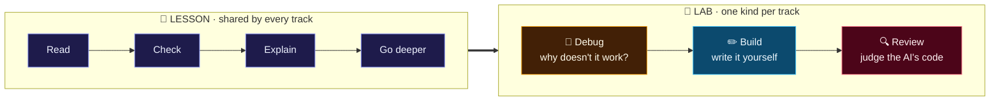
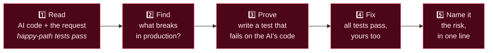
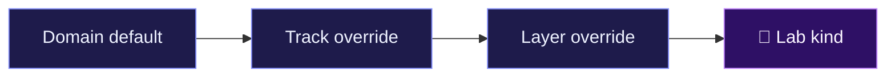
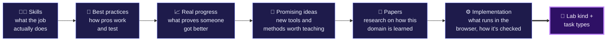
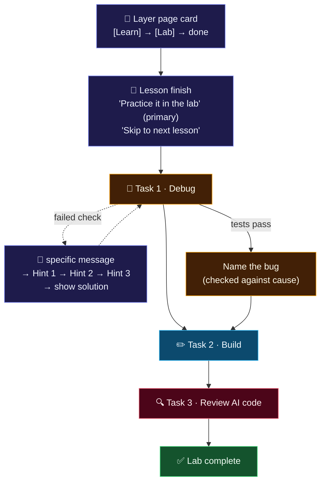
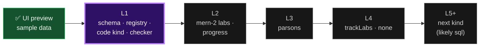

# 🧪 Lab system

> [!NOTE]
> **Status · 2026-10-20**
> - 📝 Design proposed 2026-10-19
> - ✅ **First real lab works end to end** (mern-2, closures): the corridor of 9 rooms (`/labs`), a room page with sections (`/labs/:room`), and the lab workspace (`/learn/:track/:layer/:topic/lab`) with **real grading** in the sandboxed worker, real hints and solution, saved progress, and roadmap links both ways (`src/features/labs/`)
> - ⏳ Only 1 lab exists; every other lesson shows "No lab for this lesson yet"
> - 🎯 Pilot: MERN layers 1–3
>
> Extends [`LEARNING_SYSTEM.md`](LEARNING_SYSTEM.md). **Lessons teach; labs are where the learner practices.**

**Contents:** [Problem](#-the-problem) · [Idea](#-the-idea-same-method-different-lab) · [The lab UI](#-the-lab-ui) · [Task `review`](#-task-type-review-judge-the-ais-code) · [Research](#-research-behind-it) · [Lab kinds](#-lab-kinds) · [Architecture](#%EF%B8%8F-architecture) · [Schema](#-schema-draft) · [Flow](#-flow) · [Scope](#-scope) · [Stages](#%EF%B8%8F-build-stages) · [Open question](#-open-ai-writing-the-answers)

---

## ❓ The problem

**176 tracks · 1,785 layers · 14,329 lessons.** A TypeScript learner and a quantum
learner don't practice the same way, so one lesson format with one code panel
can't serve every track. Hand-writing every lesson can't either.

## 💡 The idea: same method, different lab

How people learn is the same in every subject. **What they practice on is not.**



| | Route | What it is |
| --- | --- | --- |
| **Lesson core** (built, stage 1) | `/learn/:track/:layer/:topic` | Read, predict/MCQ, explain back, Go deeper. The inline code panel stays for worked examples ("see it work") |
| **Lab** (UI preview built) | `/learn/:track/:layer/:topic/lab` | A full-screen workspace with graded tasks. Each track declares which lab kind it uses |

---

## 🎨 The lab UI

The preview at `/learn/mern/mern-2/how-closures-capture-free-variables-in-the-scope-chain/lab`
shows the final layout with sample data (`src/features/labs/mockLab.js`).

```text
┌──────────────────────────────────────────────────────────────────────────────┐
│ ←  🧪 LAB · ~15 MIN                         (✓) Debug ── (✓) Build ── (◎) Review AI code │
│    How closures capture free variables…                                     │
├──────────────────────────┬───────────────────────────────────────────────────┤
│ [Review AI code] Task 3/3│ memoize.js [AI] │ memoize.review.test.js   [▶ Run tests ⌃↵] │
│ The AI's memoize leaks…  │───────────────────────────────────────────────────│
│                          │  1  function memoize(fn) {                        │
│ 👤 Request to the AI     │  2    const cache = new Map();                    │
│ 🤖 The AI wrote it.      │  3    …                                           │
│    Its own tests pass.   │                                                   │
│                          ├───────────────────────────────────────────────────┤
│ ① Read  ② Find  ③ Prove  │ Tests 2/3 ███████░░░   Console                    │
│ ④ Fix   ⑤ Name it        │ AI'S TESTS   ✓ returns the cached result          │
│                          │              ✓ calls fn once per key              │
│ 💡 Stuck? nudge → hint → │ YOUR TEST    ✗ cache stays bounded                │
│    near answer → solution│              Expected size ≤ 100, received 10000  │
└──────────────────────────┴───────────────────────────────────────────────────┘
```

| Part | Design choice | Why |
| --- | --- | --- |
| **Mission stepper** | Debug → Build → Review as stations on a track that fills purple | The lab feels like a short mission, not a worksheet |
| **Color per task type** | 🟠 amber Debug · 🔵 sky Build · 🔴 rose Review AI code; purple stays the brand thread | The learner always knows which mode they're in |
| **Brief (left)** | Type chip, goal checklist or the 5 review steps lighting up | What to do is always visible next to the code |
| **Hint ladder** | 3 locked rungs: nudge → hint → near answer, then "Show solution" | Stuck learners never quit, but always try first |
| **File tabs** | The AI's file carries an **AI** badge; review tasks add a test file | Makes "this was written by an AI" explicit |
| **Results dock** | Grouped: AI's tests · Your test · Hidden tests, with exact *expected / received* | Feedback that says what's wrong (Hattie & Timperley) |
| **Name it** | After passing: type the bug, or pick the risk (Concurrency · Security · Performance · Boundary) | Turns "I got it to pass" into "I understand what was wrong" |

---

## 🔍 Task type `review`: judge the AI's code

> [!IMPORTANT]
> **The AI-era task.** Most new code a developer touches is written by an AI, so
> the skill to practice is judging it. AI is weakest on **concurrency, security,
> performance and system boundaries**, so every `review` task hides a bug there.



<details>
<summary><b>Example for MERN: the overselling order handler</b></summary>

An Express handler checks stock, then decrements it in **two separate queries**.
It passes the given tests; two parallel orders oversell. The learner writes the
parallel test, fixes it with an atomic update, and names the **race condition**.

The UI preview's sample uses a closures-lesson version: an AI-written `memoize`
whose cache grows forever, a memory leak in a long-running server (risk: **Performance**).

</details>

**Checks:**
- the learner's test must **fail** on `aiCode` and **pass** on their fix
- the hidden `tests` must pass
- `risk` is matched like the `fix` task's `cause`

This makes the lab harder to finish by pasting it into an AI, because step 3 asks
for a test that proves a specific failure.

---

## 📚 Research behind it

From the learning-science literature I know; send papers and I'll check the design against them.

| Finding | Source | What it means for labs |
| --- | --- | --- |
| Novices learn best from explicit instruction before solving | Kirschner, Sweller & Clark 2006 | Lesson first, lab second. The lab is never the first screen |
| PRIMM: Predict, Run, Investigate, Modify, Make | Sentance, Waite & Kallia 2019 | Lesson covers P-R-I, lab covers Modify then Make |
| Use-Modify-Create | Lee et al. 2011 | Task order inside a lab: work with given code first, then write new code |
| Finding and fixing errors teaches deeper than only studying correct examples | Adams et al. 2014; McLaren et al. 2016 | Task 1 is "why doesn't it work?": broken code, failing tests |
| Parsons problems teach as well as writing code, in less time | Parsons & Haden 2006; Ericson et al. 2017 | A cheap middle task type that works in every lab |
| Faded worked examples | Renkl & Atkinson 2003 | Starter code shrinks from task to task |
| Expertise reversal: help that aids novices slows experts | Kalyuga et al. 2003 | Experienced learners can skip to the last task |
| Step-level feedback gets close to human tutoring (d ≈ 0.76) | VanLehn 2011 | Every lab needs an automatic checker |
| Feedback that says what's wrong and what to try next beats right/wrong | Hattie & Timperley 2007 | Failed checks show a specific message, then the 3-hint ladder |
| Interactive simulations with built-in limits help learners explore | Wieman, Adams & Perkins 2008 (PhET) | Circuit, SQL and diagram labs are simulations, not videos |
| Retrieval and spacing | Roediger & Karpicke 2006; Cepeda et al. 2006 | Lab tasks feed the daily warm-up later |
| Erroneous examples + code review as a skill | Adams et al. 2014; the AI-era shift (`LEARNING_SYSTEM.md`, "Why") | Task type `review` |

---

## 🧰 Lab kinds

One small set of lab kinds covers all tracks. A track without a lab still gets
full lessons (the `none` kind). The kind is set **per track**, and a layer can
**override** it: the MERN layer on MongoDB uses `nosql`, the rest of MERN uses `code`.



| | Kind | Practice surface | Checker | Tracks | Runtime |
| :---: | --- | --- | --- | --- | --- |
| ✅ | **`code`** | Editor, Run, tests | Arena test runner (Jest shim, worker) | languages (JS/TS), fullstack, dsa, backend (Node) | built |
| | `sql` | Query editor, result table | Compare result rows | postgres-dba, mysql-dba, data-modeler, datascience | PGlite or sql.js |
| | `nosql` | Query shell per store | Compare returned data and final state | mongodb-admin, nosql-engineer, redis, cassandra, graph-db, vector-db | in-browser engines (e.g. mingo) |
| | `dbops` | Simulated cluster: replicas, backups, failover | State after the learner's actions | db-reliability, DBA layers | simulation |
| | `preview` | HTML/CSS/React with live page | DOM assertions | frontend, web3-frontend, web-game | sandboxed iframe |
| | `python` | Editor, Run, tests | pytest-style asserts | python, aiml, datascience | Pyodide |
| | `circuit` | Drag gates on qubits | Compare final state vector | quantum | small JS simulator |
| | `contract` | Contract editor, deploy, call, transact | Call results, events, balances, failed attacks | smart-contract, ethereum-dev, blockchain-security, defi, nft, dao, layer2 | solc-js + in-browser EVM |
| | `chain` | Simulated network: blocks, hashes, forks | Final chain state + prediction | blockchain-core, bitcoin-dev, chain-architect, cosmos, zk | JS simulation |
| | `dapp` | Web page wired to a local chain + test wallet | Page behaviour + on-chain result | dapp, web3-frontend, web3-fullstack, wallet, gamefi, indexer | `preview` + `contract` |
| | `terminal` | Commands, YAML, Dockerfiles | Rule checks on the result | devops, cloud, cybersecurity | simulated shell |
| | `diagram` | Connect boxes and arrows | Required parts and links present | system-design, architect tracks | none |
| | `none` | No workspace | Lesson checks only | GRC, manual QA, game design, research | none |

---

## 🧭 Designing a lab for each domain

> [!IMPORTANT]
> **The learning method is shared; the practice is not.** Quantum, blockchain,
> web3 and databases are learned differently from JavaScript. Each domain's lab is
> designed from evidence, not guessed, with a short **lab design brief** written
> *before* building that domain's lab kind.



| Domain | Practice surface | What proves progress | Brief |
| --- | --- | --- | :---: |
| 💻 Code (MERN, JS/TS) | Editor + tests | Tests pass; the learner's own test catches the AI's bug | ✅ this doc |
| ⚛️ Quantum | Circuit simulator | Final state vector matches; prediction before running was right | ⏳ |
| ⛓️ Blockchain / web3 | Local chain + test wallet | Contract survives the attack test; balances and events are right | ⏳ |
| 🗄️ Databases | Query editor / simulated cluster | Result rows and query plan are right; data survives the failover | ⏳ |

The founder brings papers and ideas for each domain; the brief is filled together
before that domain's kind is built. Template: the six questions above, one short
paragraph each, plus the task types they lead to.

---

## 🏛️ Architecture

A **plugin registry**: the lab page knows nothing about any one kind. Each kind is
a lazy chunk, so a quantum learner never downloads the SQL engine.

```text
src/features/labs/
  LabsPage.jsx           /labs hub (Learn menu)                       ✅ preview
  LabPage.jsx            /learn/:track/:layer/:topic/lab?task=N        ✅ preview
  components/            TaskStepper, TaskBrief, HintLadder,
                         Workspace, ResultsDock, NameItCard            ✅ preview
  mockLab.js             sample lab (UI only, no grading)              ✅ preview
  taskTypes.js           per-type label, icon, colors                  ✅
  content/
    schema.js            zod: lab + fix / write / review tasks         ✅ L1a
    index.js             loadLab(track, layer, lesson): lazy per lab   ✅ L1a
    labs.test.js         every lab must work (see Schema note)         ✅ L1a
    <track>/<layer>/<lesson>.js   one lab per lesson                   ✅ closures lab
  registry.js            kind -> () => import("./kinds/<kind>")        ⏳ L1
  trackLabs.js           domain default -> track -> layer -> kind      ⏳ L4
  kinds/code/            index.js exports { Workspace, check, taskSchema }  ⏳ L1
  kinds/sql/ …           added one at a time, by demand                ⏳ later
```

Each kind module exports the same three things:

| Export | Role |
| --- | --- |
| `Workspace` | The practice UI for that kind |
| `check(task, work)` | Runs in a worker, returns `{ passed, results[] }` |
| `taskSchema` | The zod schema for its tasks; validates hand-written labs now and AI-generated labs later |

> [!WARNING]
> Grading runs in the browser: fast, free, works offline. **A browser result can be
> faked**, so it only drives practice progress. Anything that counts (XP, layer
> pass) is re-checked on the server or comes from the layer test and voice defense.
> XP still only goes through `awardXp`.

---

## 🧾 Schema (draft)

```js
// shared by every kind
const baseTask = {
  id: z.string(),                 // stable, progress is stored against it
  title: z.string(),
  prompt: z.string(),             // markdown
  hints: z.array(z.string()).length(3), // nudge, hint, near-answer
};

// kinds/code/taskSchema
const codeTask = z.discriminatedUnion("type", [
  // "Why doesn't it work?": starter is broken code that fails the tests
  z.object({ ...baseTask, type: z.literal("fix"), starter, tests, solution, cause }),
  // "Write it yourself": starter is a near-empty stub
  z.object({ ...baseTask, type: z.literal("write"), starter, tests, solution }),
  // "Review the AI's code": aiCode passes happyTests but fails in production
  z.object({ ...baseTask, type: z.literal("review"), request, aiCode, happyTests, tests, solution,
             risk: z.enum(["concurrency", "security", "performance", "boundary"]), riskNote }),
  // later: z.object({ ...baseTask, type: z.literal("parsons"), lines, distractors, tests }),
]);

```

> [!NOTE]
> **Decided 2026-10-20 (L1a):** labs live in **their own files**
> (`src/features/labs/content/<track>/<layer>/<lesson>.js`), not inside the lesson
> file. Labs can then exist for lessons whose step content isn't written yet, and
> lesson files stay small. The built schema is `src/features/labs/content/schema.js`;
> the review task also carries `testFile`, `testStarter` and a reference `proofTest`.

> [!NOTE]
> Lesson content tests also run every task's `solution` against its `tests` (must
> pass) and its `starter` (must fail), and check each `review` task's `aiCode`
> passes `happyTests` but fails `tests`. A broken lab can't ship.

---

## 🔄 Flow



A lesson counts as done when its lab is passed. Lessons whose track has no lab
count as done after the lesson itself.

---

## 🎯 Scope

> [!TIP]
> **The smallest version worth building:** a learner finishes the closures lesson,
> opens its lab, debugs, writes and reviews code against real tests, and passes in
> **under 15 minutes**.

| Feature | Decision | Why |
| --- | :---: | --- |
| Lab route + registry + `code` kind | 🟢 **Must** | The whole idea; code reuses the Arena runner |
| `fix` and `write` tasks with tests | 🟢 **Must** | Debugging plus writing: the practice half of PRIMM |
| `review` task (judge the AI's code), one per MERN lab | 🟢 **Must** | The AI-era skill and the answer to "why learn this way"; no competitor teaches it |
| 3-hint ladder, then show solution | 🟢 **Must** | Without it stuck learners quit |
| Labs for the 2 written mern-2 lessons | 🟢 **Must** | Proves the flow end to end |
| `parsons` tasks | 🟡 Should | Cheap, strong research, works in every kind |
| `trackLabs.js` mapping + `none` | 🟡 Should | Needed before a second track |
| `sql` kind | 🔵 Later | Second kind, picked by demand |
| Other kinds, AI-generated labs, server grading, AI hints | ⚪ Won't, for now | Each waits for a real trigger (below) |

| Waits for | Trigger to revisit |
| --- | --- |
| Second lab kind | Users ask for a track that needs it, or mern-2 lab completion is above 50% |
| AI-generated labs | 3+ hand-written labs pass review, so the generator has examples |
| Server grading | Labs start awarding XP |

> [!CAUTION]
> **Riskiest assumption:** learners open the lab instead of skipping to the next
> lesson. Test with 5 developers on mern-2 before building a second kind.
> **The number to watch:** lessons finished with the lab passed, per week.

---

## 🏗️ Build stages



| Stage | What ships | Done when |
| --- | --- | --- |
| ✅ **Preview** · 2026-10-20 | Full lab UI with sample data: `/labs` hub, workspace, stepper, brief, hints, editor, results, name-it | Clickable end to end; results simulated |
| ✅ **L1 + L2 for mern-2** · 2026-10-21 | Schema + real closures lab (`content/`), checker (`lib/checkTask.js`) on the Arena's sandboxed worker, review task proof (your test must fail on the AI's code and pass on your fix), hint ladder with solution, name-it with the real cause, lab progress that marks the lesson done on the roadmap, 🧪 Lab badge on roadmap lessons, "no lab yet" page | Lab grades real code; 186 frontend tests pass; production build includes the worker and each lab chunk |
| **L1** | Lab schema, registry, `code` kind with `fix`/`write`/`review`, check in a worker, hint ladder wired to real data | Closures lab passes and fails correctly in the browser; content tests run solutions, starters and `review` checks |
| **L2** | Labs for both mern-2 lessons, lesson finish screen and layer card link to the lab, lab-done progress (localStorage until the progress API) | Layer card shows Learn / Lab / done |
| **L3** | `parsons` tasks | One parsons task per lab |
| **L4** | `trackLabs.js` mapping, `none` kind, lab picked by track | A non-JS track lesson shows no lab cleanly |
| **L5+** | Next kind by demand (likely `sql`), then the generator per kind | Per kind |

Replaces stage 2 ("graded exercises") of [`LEARNING_SYSTEM.md`](LEARNING_SYSTEM.md).

---

## 🤔 Open: AI writing the answers

A learner can paste a lab task into an AI and get the solution. **Not solved yet**,
to discuss later.

Current position: labs are practice, they award no real XP and nobody is judged
on them. Proof comes from the layer test and the voice defense, which an AI can't
take for the learner. The `review` task's "write a test that proves the failure"
step also makes pasting harder.
