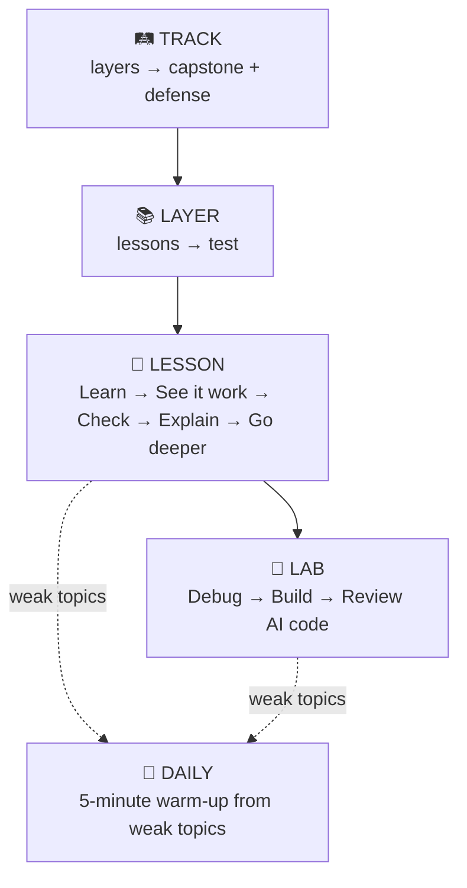

# 🎓 Learning system

> **Status · 2026-11-09**
> - ✅ Step-by-step lesson player; 2 draft lessons in `mern-2`
> - ✅ Roadmap tree tracks lesson progress automatically (localStorage until stage 3)
> - ✅ First real lab (mern-2, closures), see [`LAB_SYSTEM.md`](LAB_SYSTEM.md)
> - 🎯 **Pilot track: MERN, layers 1–3.** The gap is content: 2 of 24 lessons written
>
> **Code:** `src/features/learn/` · `src/features/labs/` · `src/features/roadmap/lib/nodeProgress.js`

## 💡 Why

A developer doesn't learn from an intro paragraph and a link to someone else's docs. They learn by **reading a real explanation, then writing code, getting feedback, and explaining it back.**

**The fair critique:** *"AI writes the code and explains anything on demand. Why a structured path?"* Part of it is right: memorizing syntax is mostly dead. But depth matters **more** now:

1. **The job shifts from writing code to judging it.** Reviewing AI output and spotting the subtle bug needs a mental model of how things work.
2. **AI is weakest exactly where depth matters:** concurrency, security, performance, system boundaries. Code that doesn't break in production is not cheap.

Also: you can't ask about what you don't know exists (the path is the map), and when everyone can produce code, the scarce hiring signal is **proof of understanding**. Early studies point the same way (Anthropic 2026 on skill formation with AI help; METR 2025 on experienced developers being slower with AI). *Re-check the exact numbers before quoting them publicly.*

> **Positioning:** *AI writes the code. Vahoha makes sure you understand it well enough to be the one in charge.*

| Idea | Where it lives | What the learner does |
| --- | --- | --- |
| Judge code, don't just write it | Lab task **`review`**, lesson step **"Where AI gets it wrong"** | Finds the hidden bug in plausible AI code, proves it with a test, fixes it |
| AI is weak on concurrency, security, performance, boundaries | Content rubric (stage 6) | Every lesson covers how the thing **fails in production** |
| Depth matters | **Go deeper** levels 3–4 | Reads how it works under the hood and why it was designed that way |
| Proof of understanding | **Explain back**, capstone defense | Explains in their own words |
| Use AI the right way | **Mentor hint ladder** | Gets nudges and hints, never the full answer in practice |

## 🗺️ The system at a glance

## 📖 One lesson

Read first, then practice, the way programmers learn from a good book.

| Step | The learner | Research |
| --- | --- | --- |
| 📖 **Learn** | Reads a real explanation: how it works, with code | Explicit instruction for novices (Kirschner, Sweller & Clark 2006) |
| ▶️ **See it work** | Runs a working example in the browser | Worked examples (Sweller) |
| ❓ **Check** | 2–3 questions, at least one "predict the output" | Retrieval practice (Roediger & Karpicke 2006) |
| 🤖 **Where AI gets it wrong** | Judges a plausible AI answer: what breaks, and why | Erroneous examples (Adams et al. 2014) |
| 🗣️ **Explain** | Types the idea in own words; quick feedback, not graded | Self-explanation (Chi et al. 1994) |
| 🧠 **Go deeper** | Optional deeper levels (below) | |
| 🧪 **Lab** | Fix, write and review code against tests ([`LAB_SYSTEM.md`](LAB_SYSTEM.md)) | Use-Modify-Create (Lee et al. 2011) |

- **Mentor** knows the track, layer and lesson. Hint ladder: nudge → hint → fix.
- **Mastery:** every step feeds it. Weak topics return in the daily warm-up after 1, 3, 7 and 14 days (spaced repetition, Cepeda et al. 2006).
- **Progress is recorded by the system, never ticked by hand:** lesson opened → in progress; finished in the player (or its lab passed) → done; layer test passed → done for every lesson in the layer.
- **Tracks the browser can't run** (Python, Go, Rust…) replace the code steps with Foundations `predict`, `trace` and `observe` until a server sandbox exists.

## 🧠 Go deeper: the depth ladder

Go deeper is **our own detailed explanation** of each topic, written and reviewed in the same pipeline as lessons. Books and official docs are its sources, not its content.

| Level | Question | Example: JS event loop | Where |
| --- | --- | --- | --- |
| 1️⃣ Use it | How do I use it? | `setTimeout`, `await` | Lesson |
| 2️⃣ How it works | What happens? | Call stack, task queue | Lesson |
| 3️⃣ Under the hood | How is it built, and how does it break? | libuv, V8, microtasks vs macrotasks; a starved task queue in production | **Go deeper** |
| 4️⃣ Why this design | Tradeoffs and history | Why JS is single-threaded, vs threads | **Go deeper** |

Mastery records the deepest level reached. Deep pages are public and pre-rendered, which also makes them a source of search traffic.

## 🎙️ Layer exam

| | Checks | Status |
| --- | --- | --- |
| **MCQ** | Knowledge | Built (`examEngineService`). See [`EXAM_INTEGRITY.md`](EXAM_INTEGRITY.md) |
| **Voice defense** | Understanding: explain one random topic, answer 2 follow-ups, graded against a concept rubric | Frozen until pilot data. Optional for the pilot (D1) |

## 🎯 Pilot: MERN

Everything is proven on one track before any other gets content.

| MERN layers 1–3 | Status |
| --- | --- |
| 📖 Lessons | ⏳ **2 of 24 written** (`mern-2`), both `draft` ← the gap |
| 🧪 Labs | ⏳ 1 (mern-2 closures) |
| ❓ Test questions | ✅ 60 per layer written (`docs/exam-prompts/fullstack/mern-output.md`) · import and hand-check pending |
| 💻 Coding challenges | ✅ 5 per layer |
| 🚀 Capstone | ✅ exists |
| 🐛 Known content bug | ⚠️ `mern-3` topic *"Synthetic events and event pooling"* (`src/data/roadmaps/fullstack.json`) teaches pooling, which React 17 removed: replace it |

> **Watch two numbers:** lesson completion (started → finished) and 7-day return. If they're low on 24 good lessons, more content won't fix it.

## ⚖️ Decisions

| # | Decision | Status |
| :---: | --- | --- |
| **D1** | Voice gate | **Optional for the pilot** ("Verified" badge only). Gating unvalidated users adds friction before we know they want the product |
| **D2** | Content source | AI drafts in the lesson schema from fetched official docs → a script validates and runs the code → the founder reviews. One hand-written rubric decides what to keep |
| **D3** | Pilot | **MERN, layers 1–3** (decided 2026-10-20), for lessons, tests, challenges and capstone together |

## 🏗️ Build stages

Each stage ships on its own. A lesson without a content file keeps the old page, so there is no big-bang migration. **Order:** 6 → 3 → labs → 4. Content is the bottleneck, so it goes first.

| Stage | What ships | Done when |
| --- | --- | --- |
| ✅ **1** | Step player: one step per screen (`?step=N`), questions between steps, live code panel, predict steps lock Run until answered, explain-back, Go deeper on the finish screen | Done 2026-10-18 |
| ✅ **Auto progress** | Roadmap tree shows lesson progress (`lessonStatus.js`, `nodeProgress.js`) | Done 2026-10-20 |
| 🎯 **6 · next** | Content pipeline: hand-written rubric, AI drafts lessons + Go deeper from official docs, a script validates and runs the code, founder reviews. Write MERN layers 1–3 (24 lessons) | A lesson verify script (not written yet) passes for mern-1..3 |
| **3** | Progress on the server: `lesson_progress` collection and API behind `lessonStatus.js` | Progress survives devices; the funnel can read it |
| **Labs** | More `code` labs ([`LAB_SYSTEM.md`](LAB_SYSTEM.md)) | A learner passes a lab in under 15 minutes |
| **4** | Explain gets AI feedback against `mustMention`; result feeds mastery | Weak explanations mark the topic `shaky` |
| **5** | Mentor opens with lesson context | Mentor's first reply names the lesson |
| **7** | Daily warm-up (spaced review, 1/3/7/14 days) | Due items appear on `/progress` |
| **8** | Voice defense in the layer test (D1) | Defense result shows as "Verified" |
