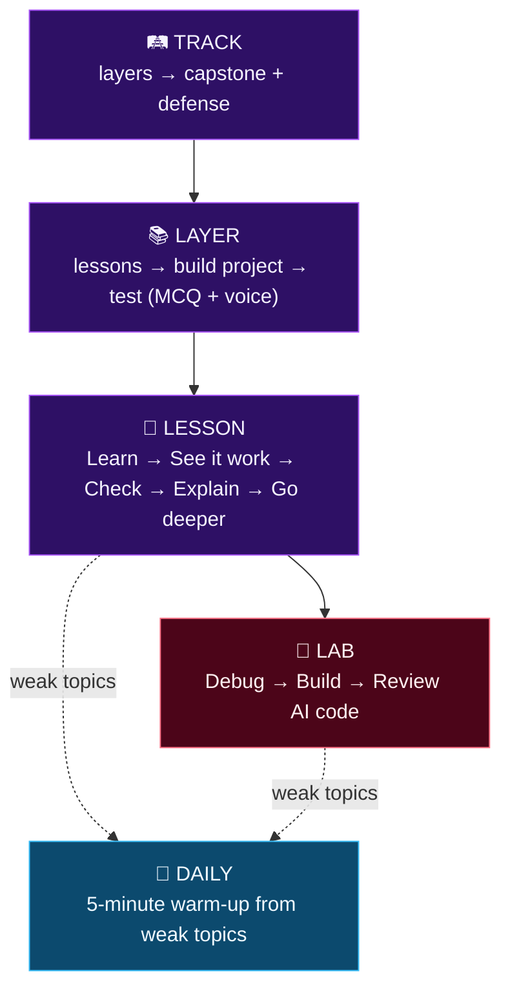
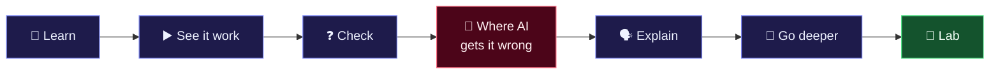
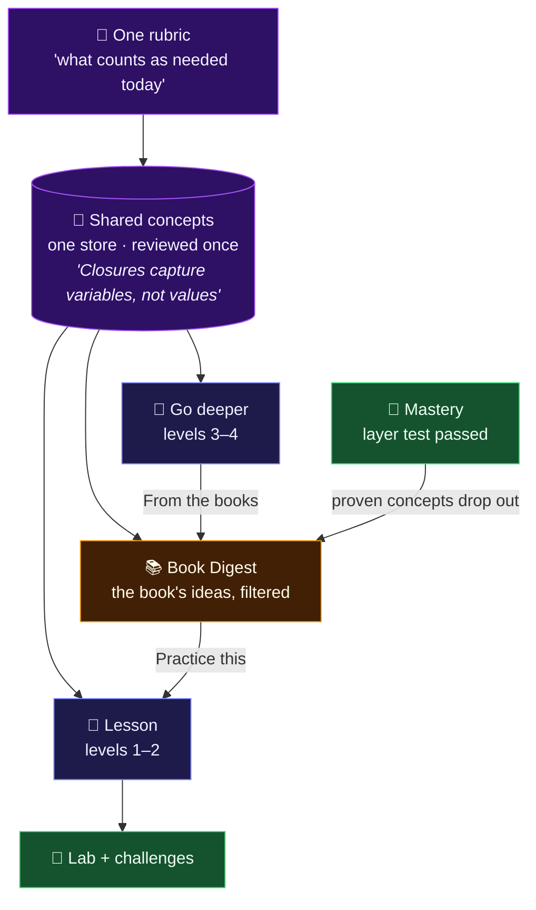

# 🎓 Learning system

> [!NOTE]
> **Status · 2026-10-20**
> - ✅ Stage 1 built: step-by-step lesson player, 2 draft lessons in `mern-2`
> - ✅ Roadmap tree tracks lesson progress automatically (localStorage until stage 3)
> - 🧪 Lab UI built as a preview with sample data: `/labs` hub + `/learn/:track/:layer/:topic/lab`
> - 🎯 **Pilot track: MERN, layers 1–3**
>
> Replaces the old lesson page at `/learn/:trackId/:layerId/:topicSlug` (one description plus external links).

| | |
| --- | --- |
| **Related docs** | [`LAB_SYSTEM.md`](LAB_SYSTEM.md) · [`VOICE_EXAM_SPEC.md`](VOICE_EXAM_SPEC.md) · [Book Digest](../ideas/book-digest/README.md) · [`BIG_BETS.md`](../strategy/BIG_BETS.md) |
| **Code** | `src/features/learn/` · `src/features/labs/` · `src/features/roadmap/lib/nodeProgress.js` |

**Contents:** [Why](#-why) · [The system](#-the-system-at-a-glance) · [One lesson](#-one-lesson) · [Go deeper](#-go-deeper-the-depth-ladder) · [Book Digest link](#-connection-to-the-book-digest) · [Layer exam](#-layer-exam) · [Pilot](#-pilot-mern) · [Decisions](#-decisions) · [Build stages](#-build-stages)

---

## 💡 Why

A developer doesn't learn from an intro paragraph and a link to someone else's
docs. They learn by **reading a real explanation, then writing code, getting
feedback, and explaining it back.**

### Why learn this way in the AI era?

> [!IMPORTANT]
> **The fair critique:** *"AI writes the code and explains anything on demand. Why a
> structured path? Just build things and ask the AI."*

Part of it is right ✔️ memorizing syntax and APIs is mostly dead, and slow doc-reading
loses to just-in-time learning. A path that teaches like 2015 will lose.

But two things make depth matter **more** now, not less:

| | Reason | What it means |
| :---: | --- | --- |
| **1** | **The job shifts from writing code to judging it** | Reviewing AI output, spotting the subtle bug, saying *"this race condition will bite us"*: all of it needs a mental model of how things work. Without depth, a developer can only accept or reject AI code blindly. |
| **2** | **AI is weakest exactly where depth matters** | Concurrency, security, performance, system boundaries. *"Works on my machine"* code is cheap now. **Code that doesn't break in production is not.** |

Also: you can't ask about what you don't know exists (the path is the map), and
when everyone can produce code, the scarce hiring signal is **proof of
understanding**. Early studies point the same way: AI help without understanding
lowered skill formation (Anthropic, 2026), and experienced developers were slower
with AI while feeling faster (METR, 2025). *Re-check the exact numbers before
quoting them publicly.*

> [!TIP]
> **Positioning:** *AI writes the code. Vahoha makes sure you understand it well enough to be the one in charge.*

### How the "why" shows up in the product

Each idea has a concrete home, so it isn't only a slogan:

| Idea | Where it lives | What the learner does |
| --- | --- | --- |
| 🔍 Judge code, don't just write it | Lab task **`review`** ([`LAB_SYSTEM.md`](LAB_SYSTEM.md)) | Gets AI-written code that passes the happy path but hides a real bug; finds it, proves it with a failing test, fixes it, names the risk |
| 🔍 Judge code, don't just write it | Lesson step **"Where AI gets it wrong"** | Predicts what breaks in a plausible AI answer before running it |
| ⚠️ AI is weak on concurrency, security, performance, boundaries | **Content rubric** (stage 6) | Every lesson and Go deeper covers how the thing **fails in production**, not only how to use it |
| 🧠 Depth matters | **Go deeper** levels 3–4 | Reads how it works under the hood and why it was designed that way |
| 🎙️ Proof of understanding | **Explain back**, **voice defense** | Explains in their own words; an AI can't take the defense for them |
| 🤝 Use AI the right way | **Mentor hint ladder** | Gets nudges and hints, never the full answer in practice |

---

## 🗺️ The system at a glance

---

## 📖 One lesson

Read first, then practice, the way programmers learn from a good book.

| Step | The learner | Research |
| --- | --- | --- |
| 📖 **Learn** | Reads a real explanation: how it works, with code | Explicit instruction for novices (Kirschner, Sweller & Clark 2006) |
| ▶️ **See it work** | Runs a working example in the browser | Worked examples (Sweller) |
| ❓ **Check** | 2–3 questions, at least one "predict the output" | Retrieval practice (Roediger & Karpicke 2006) |
| 🤖 **Where AI gets it wrong** | Judges a plausible AI answer: what breaks, and why | Erroneous examples (Adams et al. 2014) |
| 🗣️ **Explain** | Says or types the idea in own words; quick feedback, not graded | Self-explanation (Chi et al. 1994) |
| 🧠 **Go deeper** | Optional deeper levels ([below](#-go-deeper-the-depth-ladder)) | |
| 🧪 **Lab** | Fix, write and review code against tests ([`LAB_SYSTEM.md`](LAB_SYSTEM.md)) | Use-Modify-Create (Lee et al. 2011) |

- **Mentor** knows the track, layer and lesson. Hint ladder: nudge → hint → fix. Never hands over the full answer in practice.
- **Mastery:** every step feeds it. Weak topics return in the daily warm-up after 1, 3, 7 and 14 days (spaced repetition, Cepeda et al. 2006).
- **Progress is recorded by the system, never ticked by hand:**

  | Event | Status |
  | --- | --- |
  | Lesson opened | ◉ In progress |
  | Lesson finished in the player | ✓ Done |
  | Layer test passed | ✓ Done for every lesson in the layer |

- **Tracks the browser can't run** (Python, Go, Rust…) replace the code steps with Foundations `predict`, `trace` and `observe` until a server sandbox exists.

---

## 🧠 Go deeper: the depth ladder

Depth is a main feature, not a links box. **Go deeper is our own detailed
explanation of each topic**, written in the same pipeline as lessons and
reviewed the same way. Books and official docs are its *sources*, not its content.

| Level | Question | Example: JS event loop | Where |
| --- | --- | --- | --- |
| 1️⃣ Use it | How do I use it? | `setTimeout`, `await` | Lesson |
| 2️⃣ How it works | What happens? | Call stack, task queue | Lesson |
| 3️⃣ Under the hood | How is it built, and how does it break? | libuv, V8, microtasks vs macrotasks; a starved task queue in production | **Go deeper** |
| 4️⃣ Why this design | Tradeoffs and history | Why JS is single-threaded, vs threads | **Go deeper** |
| 📚 From the books | What do the best books add? | *"2 more ideas from Eloquent JavaScript"* | Link into the Book Digest |

Mastery records the deepest level reached, so a profile can say
**"Event loop: level 3, voice-verified"**. Deep pages are public and
pre-rendered, which also makes them the main source of search and AI-answer traffic.

---

## 🔗 Connection to the Book Digest

The [Book Digest](../ideas/book-digest/README.md) and the learning system are
**two views of the same knowledge**. Both are built from one shared store of
**concepts**: a single idea with a summary, detail, level, tags, sources and the
topics it belongs to.

| From | To | How |
| --- | --- | --- |
| Lesson (topic) | Concepts | Each lesson is tagged with its concepts; its steps are written from them |
| Go deeper | Book Digest | **"From the books"** shows the digest ideas tagged with this topic, filtered by the learner's level |
| Book Digest idea | Lesson, lab, challenge | **"Practice this"** links back to the topic's lesson, its lab and challenges |
| Roadmap position | Book Digest | On `mern-2`, a book is cut to what `mern-2` needs |
| Layer test passed | Book Digest | Concepts the learner has proven drop out of the digest |

> [!IMPORTANT]
> **Rules**
> - **Lessons stay the main path.** A learner never has to read a book to pass a layer; the book is one click away for more.
> - **One rubric for both.** "What counts as needed today" is written by hand once (stage 6) and decides what a lesson keeps and what a digest keeps.
> - **"I already know this" is self-reported.** Stored separately; it never marks a lesson done. Only the system's events do.
> - **Sources must be usable.** Official docs (MDN, react.dev, Node) are openly licensed with attribution rules to check; commercial books need permission. Decide the source list before ingesting anything.

---

## 🎙️ Layer exam

| | Checks | How |
| --- | --- | --- |
| **1. MCQ** | Knowledge | Exists (`examEngineService`) |
| **2. Voice defense** | Understanding | Explain one random topic of the layer, then answer 2 follow-ups. Graded against a fixed concept rubric; every credited concept must quote the transcript (checked in code). See [`VOICE_EXAM_SPEC.md`](VOICE_EXAM_SPEC.md) |

---

## 🎯 Pilot: MERN

Everything is proven on one track before any other gets content.

| MERN layers 1–3 | Status (2026-10-20) |
| --- | --- |
| 📖 Lessons | ⏳ **2 of 24 written** (`mern-2`), both `draft` ← the gap |
| ❓ Test questions | ✅ 60 per layer written (`docs/exam-prompts/fullstack/mern-output.md`) · confirm imported and hand-checked |
| 💻 Coding challenges | ✅ 5 per layer |
| 🚀 Capstone | ✅ exists |
| 🐛 Known content bug | ⚠️ `mern-3` lesson *"Synthetic events and event pooling"* teaches pooling, which React 17 removed: replace it |

> [!TIP]
> **Watch two numbers:** lesson completion (started → finished) and 7-day return
> (came back and pressed "Continue"). If they're low on 24 good lessons, more
> content won't fix it.

---

## ⚖️ Decisions

| # | Decision | Status |
| :---: | --- | --- |
| **D1** | Voice gate | 🔄 **For the pilot: optional** ("Verified" badge only), revised from "required". Gating unvalidated users adds friction before we know they want the product. Revisit after pilot data |
| **D2** | Content source | ✅ AI drafts in the lesson schema from fetched official docs → a script validates and runs the code → the founder reviews. One hand-written rubric decides what to keep |
| **D3** | Pilot | ✅ **Decided 2026-10-20: MERN, layers 1–3**, for lessons, tests, challenges and capstone together |

---

## 🏗️ Build stages

Each stage ships on its own and ends with a working page. A lesson without a
content file keeps today's page, so there is no big-bang migration.

| Stage | What ships | Done when | Reuses |
| --- | --- | --- | --- |
| ✅ **1** · 2026-10-18 | Step player: one step per screen (`?step=N`), progress bar, questions between steps, live code panel, predict steps lock Run until answered, explain-back, Go deeper on the finish screen. One real lesson | `mern-2` event-loop lesson works end to end; tests validate every lesson file and run its code | Foundations format, `curriculum.js` slugs, Arena `CodeEditor`, `MarkdownMessage` |
| ✅ · 2026-10-20 | Roadmap tree shows lesson progress, recorded automatically (open → in progress, finish → done, layer test → all done) | Status survives reload in one browser | `lessonStatus.js`, `nodeProgress.js` |
| 🎯 **6 · next** | Content pipeline: hand-written rubric, shared concept store, AI drafts concepts + lessons + Go deeper from fetched official docs, a script validates and runs the code, founder reviews. Write MERN layers 1–3 (24 lessons) | `lessons:verify` passes for mern-1..3 | `challenges:verify`, exam import flow |
| **3** | Progress on the server: `lesson_progress` collection and API, replaces localStorage behind `lessonStatus.js` | Progress survives devices; funnel can read it | Backend module pattern |
| **L1–L2** → [`LAB_SYSTEM.md`](LAB_SYSTEM.md) | Labs, `code` kind: `fix`, `write`, `review` (AI-code review) tasks. UI preview already built | A learner passes a lab in under 15 minutes | `useCodeRunner`, `testRunner.worker.js` |
| **4** | Explain gets AI feedback against `mustMention`; result feeds mastery | Weak explanations mark the topic `shaky` | Teach-back evaluator, `learnerMasteryService` |
| **5** | Mentor opens with lesson context | Mentor's first reply names the lesson | `location.state` arrival context in `AiAgent.jsx` |
| **7** | Daily warm-up (spaced review, 1/3/7/14 days) | Due items appear on `/progress` | Mastery `shaky` topics |
| **8** | Voice defense in the layer test (D1: optional for the pilot) | Defense result shows as "Verified" | [`VOICE_EXAM_SPEC.md`](VOICE_EXAM_SPEC.md) |
| 📚 **Later** | Book Digest on the shared concepts (after the MERN pilot) | One open-licensed book, one cut, "Expand this" | Stage 6 pipeline and rubric |

> [!NOTE]
> **Order:** 6 → 3 → labs L1–L2 → 4. Content is the bottleneck, so it goes first.
> Go-deeper levels 3–4 beyond MERN, the daily warm-up and other lab kinds wait
> for pilot users to ask.
